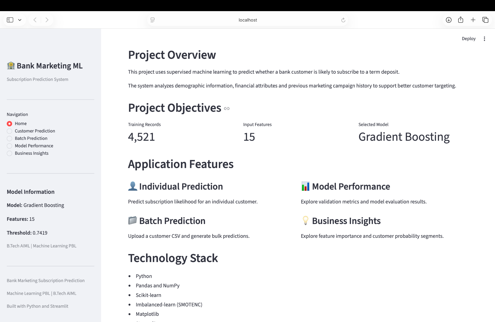
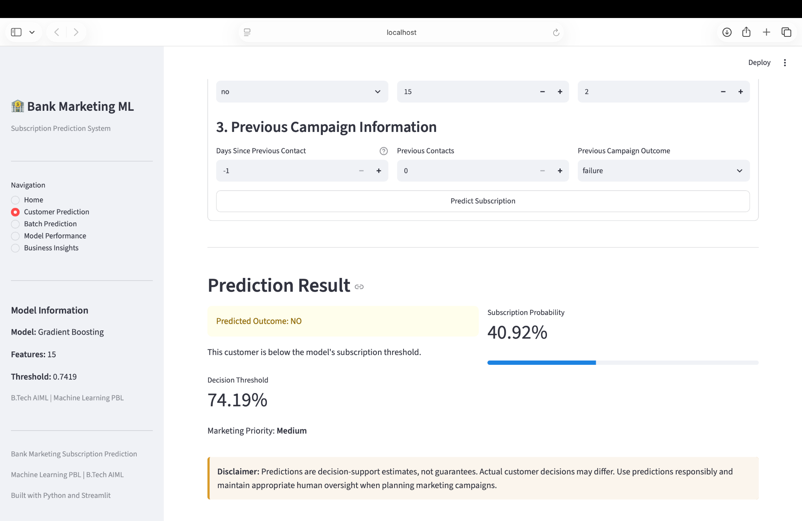
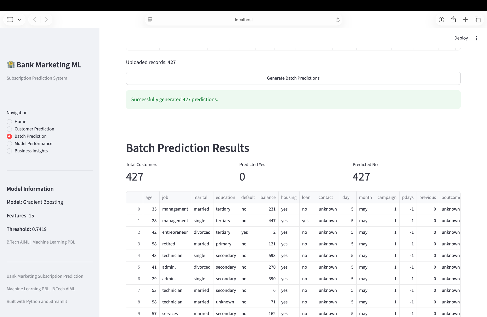
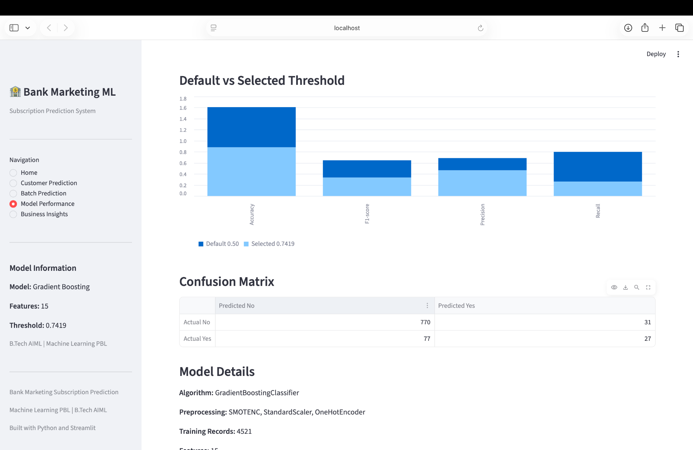
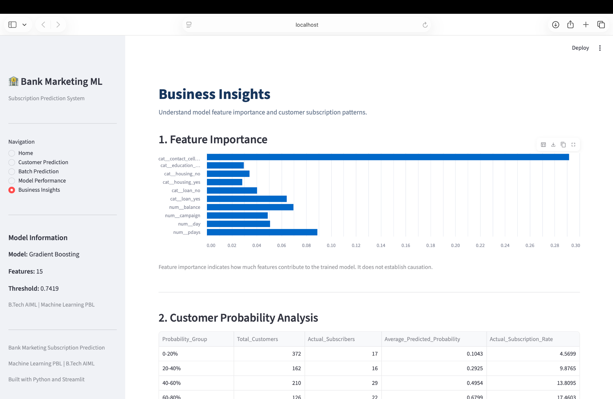

# Bank Marketing Subscription Prediction

An end-to-end Machine Learning project that predicts whether a bank customer is likely to subscribe to a term deposit based on demographic, financial and previous marketing campaign information.

Built using Python, Scikit-learn and Streamlit as part of a B.Tech Artificial Intelligence and Machine Learning project.

---

## 1. Project Overview

Banks conduct direct marketing campaigns to promote term deposits. However, contacting customers who are unlikely to subscribe can increase campaign costs and waste marketing resources.

This project develops a supervised machine learning classification system to estimate customer subscription likelihood and support more informed marketing decisions.

The application provides:
- Individual customer subscription prediction.
- Batch prediction through CSV uploads.
- Prediction probabilities and classification thresholds.
- Model performance and evaluation metrics.
- Business insights and customer probability analysis.

**Important:** Predictions are decision-support estimates, not guarantees of customer subscription.

## 2. Problem Statement

To develop a machine learning model that predicts whether a bank customer will subscribe to a term deposit (`yes` or `no`) using historical customer and marketing campaign data.

**Problem type:** Supervised Learning — Binary Classification.

**Target variable:** `y`

- `yes` — Customer subscribed.
- `no` — Customer did not subscribe.

## 3. Project Objectives

1. Understand and analyze the Bank Marketing dataset.
2. Perform data cleaning and preprocessing.
3. Conduct Exploratory Data Analysis (EDA).
4. Perform feature engineering and feature selection.
5. Train and compare multiple classification algorithms.
6. Evaluate and optimize model performance.
7. Extract meaningful business insights.
8. Package the selected model for reproducibility.
9. Develop an interactive Streamlit application.
10. Prepare complete academic documentation and presentation.

## 4. Dataset Information

**Dataset:** Bank Marketing Dataset
**Source:** UCI Bank Marketing dataset documentation
**Training records:** 4,521
**Original columns:** 17
**Target variable:** `y`

### Target distribution

| Class | Records | Percentage |
|---|---:|---:|
| No | 4,000 | 88.48% |
| Yes | 521 | 11.52% |

The dataset contains an imbalanced target distribution.

### Final model features

The final model uses 15 input features:

**Numerical features (6):**
- age
- balance
- day
- campaign
- pdays
- previous

**Categorical features (9):**
- job
- marital
- education
- default
- housing
- loan
- contact
- month
- poutcome

**Excluded feature:** `duration`

The `duration` feature is excluded because it is only known after a call has ended. Using it for pre-call prediction could introduce data leakage.

### Data quality

- Missing values: 0
- Exact duplicate records: 0
- `pdays = -1` indicates that the customer was not previously contacted.
- `unknown` is retained as a valid categorical value.

## 5. Technology Stack

| Category | Technologies |
|---|---|
| Programming language | Python |
| Data manipulation | Pandas, NumPy |
| Visualization | Matplotlib, Seaborn |
| Machine Learning | Scikit-learn |
| Imbalanced data handling | Imbalanced-learn, SMOTENC |
| Model persistence | Joblib |
| Interactive application | Streamlit |
| Development | Jupyter Notebook, VS Code |
| Version control | Git, GitHub |

## 6. Machine Learning Methodology

The project follows a structured machine learning workflow:

1. Business understanding
2. Dataset collection and understanding
3. Data preprocessing
4. Exploratory Data Analysis
5. Feature engineering and selection
6. Model development and hyperparameter tuning
7. Model evaluation and validation
8. Business insights and recommendations
9. Model packaging and reproducibility
10. Streamlit application development
11. Documentation and presentation

### Models evaluated

Five classification algorithms were developed and compared:

1. Logistic Regression
2. Decision Tree
3. Random Forest
4. Support Vector Machine (SVM)
5. Gradient Boosting

**Selected model:** Gradient Boosting Classifier.

### Preprocessing pipeline

The final saved pipeline uses:

1. SMOTENC for handling class imbalance during training.
2. StandardScaler for numerical feature scaling.
3. OneHotEncoder for categorical feature encoding.
4. Gradient Boosting Classifier for prediction.

The preprocessing steps are integrated into the saved model pipeline.

## 7. Model Performance

The selected Gradient Boosting model was evaluated using a stratified training-validation split.

**Training records:** 4,521
**Validation records:** 905
**Validation split:** 20%
**Random state:** 42

### Validation performance comparison

| Metric | Threshold 0.50 | Threshold 0.7419 |
|---|---:|---:|
| Accuracy | 72.82% | 88.07% |
| Precision | 22.05% | 46.55% |
| Recall | 53.85% | 25.96% |
| F1-score | 31.28% | 33.33% |
| ROC-AUC | 71.71% | 71.71% |
| PR-AUC | 32.11% | 32.11% |

**Selected decision threshold:** 0.7419.

The threshold was selected through validation F1 analysis. Increasing the threshold improves precision but reduces recall.

The threshold must be independently validated on future labelled data before production use.

## 8. Business Insights

The project analyzes customer segments, feature importance and predicted subscription probabilities.

### Important findings

- Retired customers showed a subscription rate of 23.48%.
- Student customers showed a subscription rate of 22.62%.
- Customers with a successful previous campaign outcome showed a subscription rate of 64.34%.
- Cellular contact had the highest feature importance in the selected model.
- The 80–100% predicted probability segment showed an observed subscription rate of 57.14% on the validation dataset.

### Recommendations

1. Prioritize promising customers using predicted probabilities.
2. Allocate marketing resources according to expected campaign benefit.
3. Consider previous campaign outcomes when planning follow-ups.
4. Monitor actual campaign outcomes.
5. Maintain human oversight in marketing decisions.

Feature importance indicates predictive contribution, not causation.

## 9. Streamlit Application

The project includes an interactive Streamlit application with five sections:

### Home
Provides the project overview, objectives and technology stack.

### Customer Prediction
Accepts individual customer details and displays:
- Predicted subscription outcome.
- Subscription probability.
- Decision threshold.
- Marketing priority.

### Batch Prediction
Allows users to upload customer CSV files and generate bulk predictions with downloadable results.

### Model Performance
Displays validation metrics, model comparisons, confusion matrix and model details.

### Business Insights
Provides feature importance, customer probability analysis and marketing recommendations.

### Application screenshots

**Home**



**Customer Prediction**



**Batch Prediction**



**Model Performance**



**Business Insights**



## 10. Project Structure

```text
Bank-Marketing-ML-PBL/
│
├── app.py
├── requirements.txt
├── README.md
│
├── data/
│   ├── raw/
│   └── processed/
│
├── notebooks/
│   ├── 01_dataset_understanding.ipynb
│   ├── 02_data_preprocessing.ipynb
│   ├── 03_exploratory_data_analysis.ipynb
│   ├── 04_feature_engineering.ipynb
│   ├── 05_model_development.ipynb
│   ├── 06_model_evaluation.ipynb
│   └── 07_business_insights.ipynb
│
├── src/
│   ├── preprocessing.py
│   ├── train.py
│   ├── evaluate.py
│   └── predict.py
│
├── models/
│   ├── best_model.joblib
│   └── model_metadata.json
│
├── reports/
│   ├── business_understanding.md
│   ├── data_dictionary.md
│   ├── eda_report.md
│   ├── feature_engineering_report.md
│   ├── evaluation_report.md
│   ├── business_insights_report.md
│   ├── model_packaging_report.md
│   ├── evaluation_results.json
│   └── predictions.csv
│
└── images/
    ├── eda/
    ├── feature_engineering/
    ├── model_development/
    ├── evaluation/
    ├── business_insights/
    └── application/
```

## 11. Installation and Execution

### Prerequisites

- Python 3.11
- Git
- pip

### Step 1: Clone the repository

```bash
git clone https://github.com/ajeetsherkar/Bank-Marketing-ML-PBL.git

cd Bank-Marketing-ML-PBL
```

### Step 2: Create a virtual environment

```bash
python3 -m venv .venv
```

### Step 3: Activate the environment

macOS / Linux:

```bash
source .venv/bin/activate
```

Windows:

```bash
.venv\Scripts\activate
```

### Step 4: Install dependencies

```bash
pip install -r requirements.txt
```

### Step 5: Run the Streamlit application

```bash
streamlit run app.py
```

The application will open in your browser, usually at:

```text
http://localhost:8501
```

The saved model and metadata must be available under the `models/` directory.

## 12. Model Artifacts and Reproducibility

The project includes:

- `models/best_model.joblib` — Saved machine learning pipeline.
- `models/model_metadata.json` — Model configuration and metadata.
- `src/train.py` — Model training script.
- `src/evaluate.py` — Model evaluation script.
- `src/predict.py` — Prediction script.

The prediction workflow uses the saved preprocessing and model pipeline.

### Prediction output

The provided `data/raw/test.csv` contains 427 customer records without target labels.

The packaged model generated 427 predictions, saved in:

`reports/predictions.csv`

All 427 records were classified as `no` at the selected threshold. This does not establish prediction accuracy because the input dataset has no ground-truth labels.

## 13. Limitations and Future Scope

### Current limitations

- The dataset contains 4,521 records.
- The target variable is imbalanced.
- Validation data was used for model selection and threshold optimization.
- Independent labelled test data was not available for final performance confirmation.
- Customer behaviour and marketing effectiveness may change over time.
- Business profitability cannot be calculated without campaign costs and subscription revenue information.

### Future scope

1. Evaluate the model on independent future campaign data.
2. Collect more representative customer records.
3. Explore advanced classification and ensemble techniques.
4. Improve probability calibration and threshold selection.
5. Integrate the model with a secure banking CRM system.
6. Monitor model drift and changing customer behaviour.
7. Introduce fairness and responsible AI monitoring.

## 14. Ethical Considerations

- Protect customer privacy.
- Use customer information only for authorized purposes.
- Evaluate potential bias and unfair discrimination.
- Avoid excessive or unwanted marketing contact.
- Maintain transparency and human oversight.
- Treat predictions as decision-support estimates rather than guaranteed outcomes.

## 15. References

1. Moro, S., Laureano, R. and Cortez, P. (2011). *Using Data Mining for Bank Direct Marketing: An Application of the CRISP-DM Methodology.* Proceedings of the European Simulation and Modelling Conference – ESM'2011, pp. 117–121.

2. UCI Machine Learning Repository — Bank Marketing Dataset documentation.

3. Scikit-learn Documentation — https://scikit-learn.org/

4. Streamlit Documentation — https://docs.streamlit.io/

5. Imbalanced-learn Documentation — https://imbalanced-learn.org/

---

## Author

**Ajeet Sherkar**
B.Tech — Artificial Intelligence and Machine Learning
Sanjivani University, Kopargaon, Maharashtra, India

**GitHub Repository:**
https://github.com/ajeetsherkar/Bank-Marketing-ML-PBL

---

*Academic Machine Learning Project — Bank Marketing Subscription Prediction.*
