# Exploratory Data Analysis Report
## Bank Marketing Subscription Prediction

## 1. Project Overview

This report presents the Exploratory Data Analysis (EDA) performed on the Bank Marketing dataset. The objective is to understand customer characteristics, identify patterns associated with term-deposit subscriptions, and derive insights that can guide feature engineering and predictive model development.

The target variable is `y`:
- `yes`: Customer subscribed to a term deposit.
- `no`: Customer did not subscribe.

The analysis uses the training dataset containing 4,521 records and 17 columns.

## 2. Target Variable Analysis

The target distribution is:

| Subscription Outcome | Customers | Percentage |
|---|---:|---:|
| No | 4,000 | 88.48% |
| Yes | 521 | 11.52% |
| Total | 4,521 | 100% |

The dataset is imbalanced, with substantially more non-subscribers than subscribers.

**Figure 1: Target Distribution**

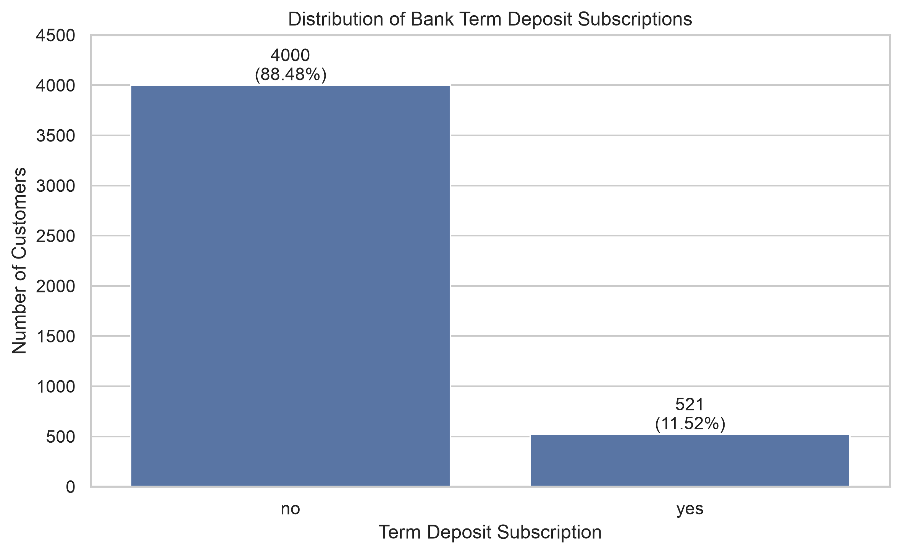

**Business implication:** Accuracy alone may be misleading during model evaluation. Precision, recall, F1-score and PR-AUC should also be considered.

## 3. Numerical Feature Analysis

The numerical features investigated were:
- Age
- Balance
- Day
- Duration
- Campaign
- Pdays
- Previous

The analysis compared distributions, descriptive statistics and boxplots.

**Figure 2: Age Distribution**

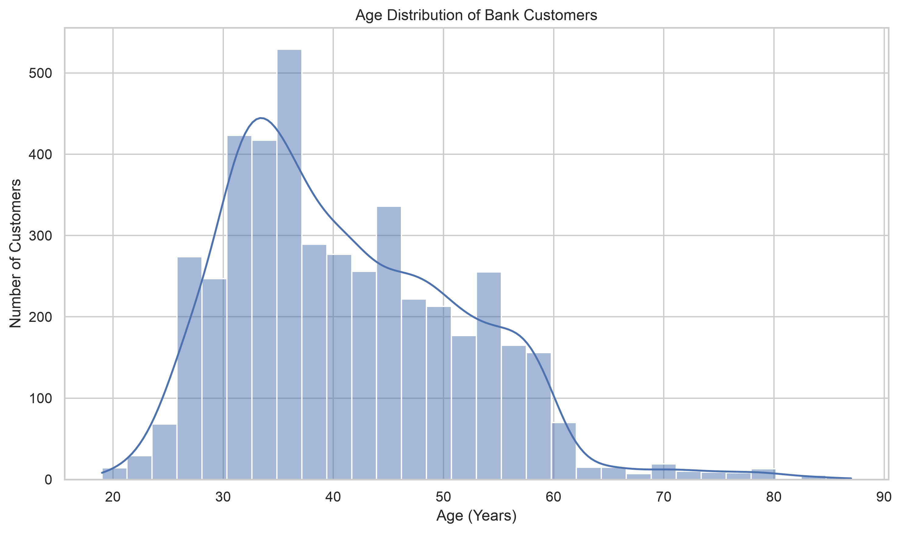

**Figure 3: Numerical Feature Boxplots**

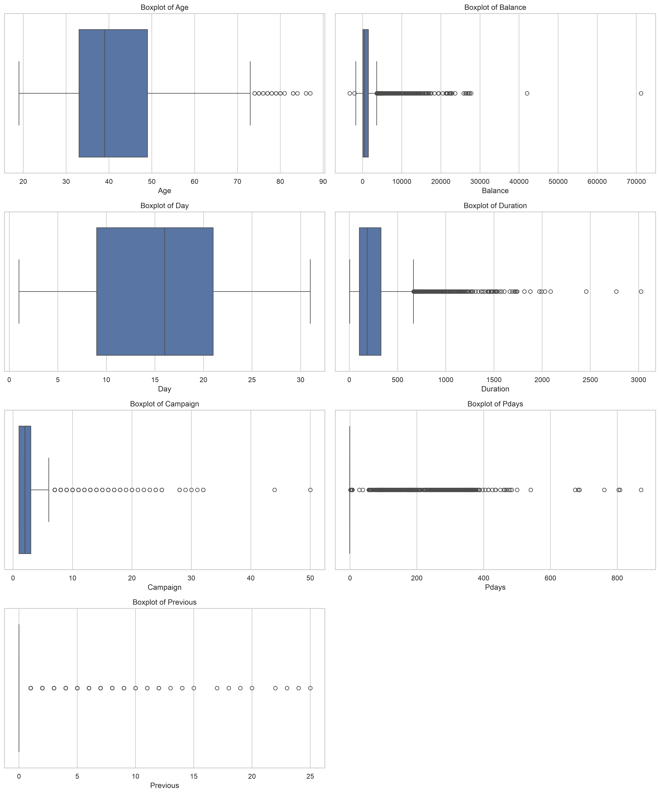

### Key observations

1. Customer ages are concentrated around the middle-age groups.
2. Balance has a highly dispersed distribution and contains extreme values.
3. Campaign contains observations with relatively high contact counts.
4. Pdays contains many `-1` values, representing customers who were not previously contacted.
5. Previous is concentrated around zero because many customers have no previous campaign contacts.
6. Statistical outliers do not necessarily represent invalid records and should not be removed automatically.

Negative account balances are retained because they can represent legitimate overdrafts.

## 4. Categorical Feature Analysis

The categorical analysis examined customer distribution across job categories and subscription rates across the following features:
- Job
- Education
- Marital status
- Housing loan
- Personal loan
- Contact month
- Previous campaign outcome
- Campaign contacts

### Job category

Management has the largest customer count (969), followed by blue-collar (946) and technician (768).

Retired customers have the highest observed subscription rate at 23.48%, followed by students at 22.62%. Blue-collar customers have the lowest observed rate at 7.29%.

**Figure 4: Customer Distribution by Job**

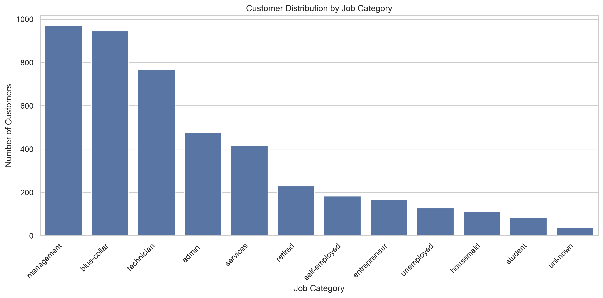

**Figure 5: Subscription Rate by Job**

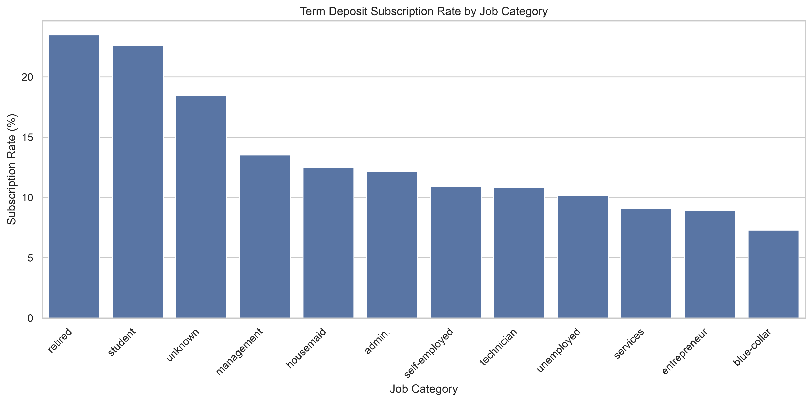

### Education

| Education | Customers | Subscribers | Subscription Rate |
|---|---:|---:|---:|
| Tertiary | 1,350 | 193 | 14.30% |
| Secondary | 2,306 | 245 | 10.62% |
| Unknown | 187 | 19 | 10.16% |
| Primary | 678 | 64 | 9.44% |

Tertiary-educated customers show the highest observed subscription rate.

### Marital status

| Marital Status | Customers | Subscribers | Subscription Rate |
|---|---:|---:|---:|
| Divorced | 528 | 77 | 14.58% |
| Single | 1,196 | 167 | 13.96% |
| Married | 2,797 | 277 | 9.90% |

Divorced and single customers show higher observed subscription rates than married customers.

### Housing loan

| Housing Loan | Customers | Subscribers | Subscription Rate |
|---|---:|---:|---:|
| No | 1,962 | 301 | 15.34% |
| Yes | 2,559 | 220 | 8.60% |

Customers without a housing loan show a higher observed subscription rate.

### Personal loan

| Personal Loan | Customers | Subscribers | Subscription Rate |
|---|---:|---:|---:|
| No | 3,830 | 478 | 12.48% |
| Yes | 691 | 43 | 6.22% |

Customers without a personal loan show a higher observed subscription rate.

### Contact month

October, December and March have the highest observed subscription rates. May has the lowest rate at 6.65%.

Some months have relatively small sample sizes, so their rates should be interpreted cautiously.

### Previous campaign outcome

| Previous Outcome | Customers | Subscribers | Subscription Rate |
|---|---:|---:|---:|
| Success | 129 | 83 | 64.34% |
| Other | 197 | 38 | 19.29% |
| Failure | 490 | 63 | 12.86% |
| Unknown | 3,705 | 337 | 9.10% |

Previous campaign success has a strong observed association with subscription.

### Campaign contacts

Campaign contact counts show varying subscription rates. The highest observed rate is for campaign 24, but it represents only three customers. Higher campaign counts generally have small sample sizes and should not be interpreted as reliable trends.

**Categorical subscription-rate figures**

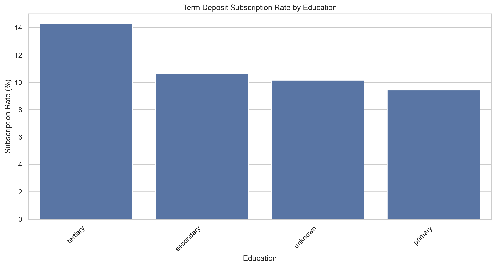

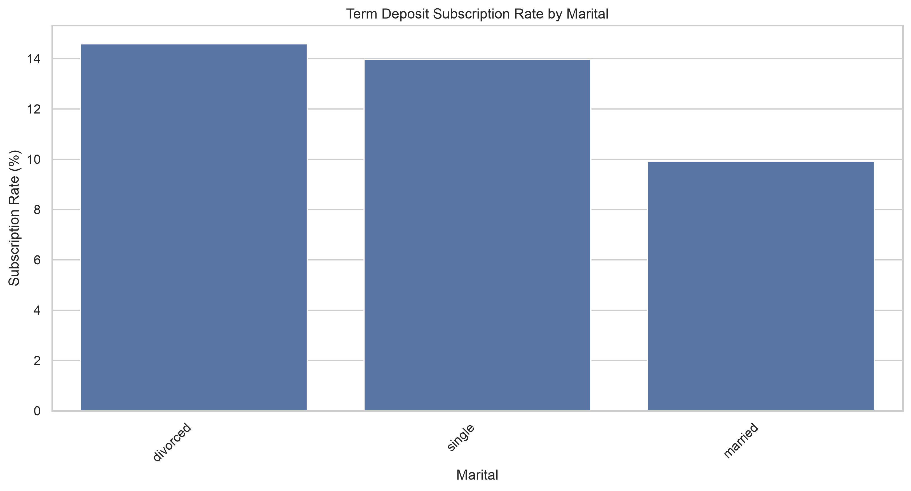

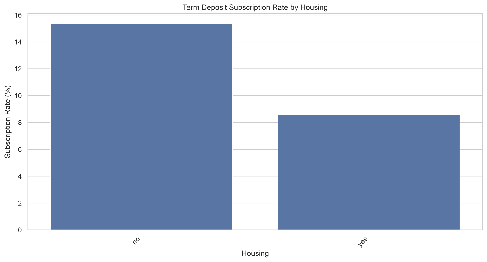

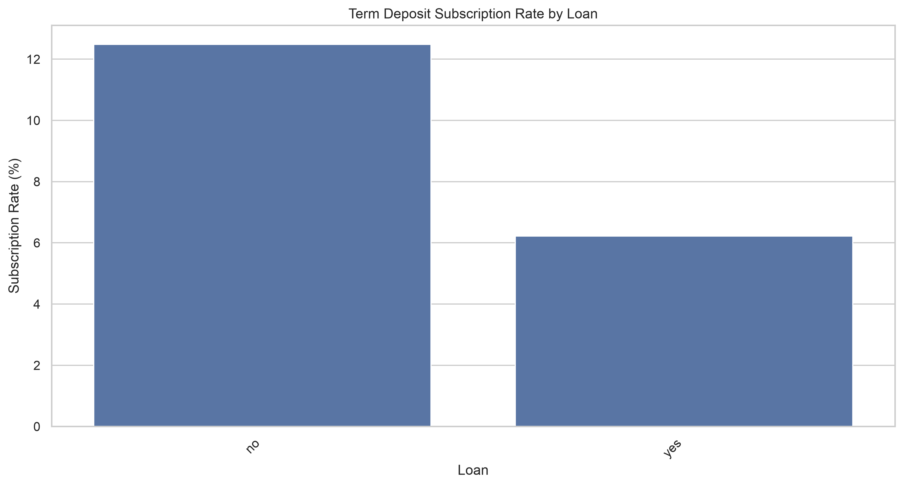

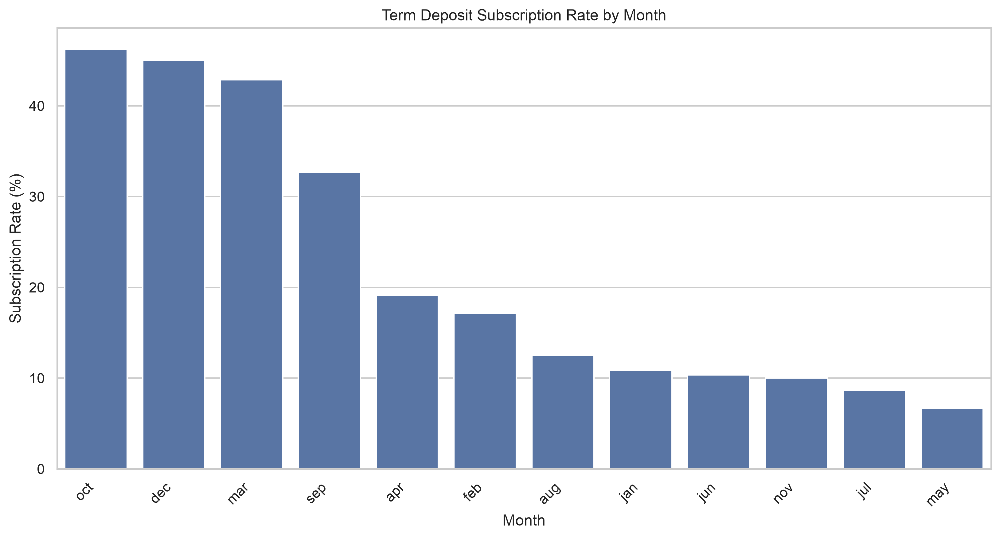

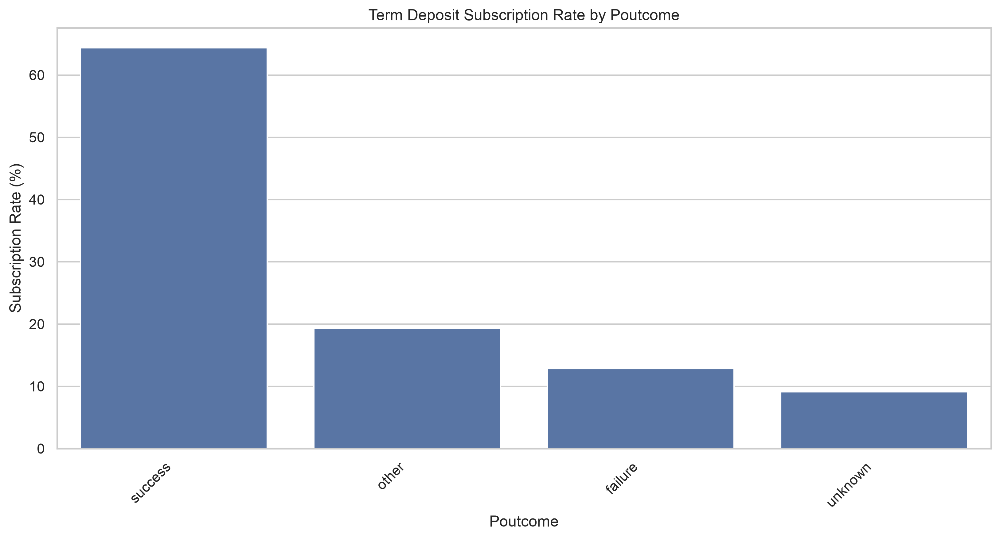

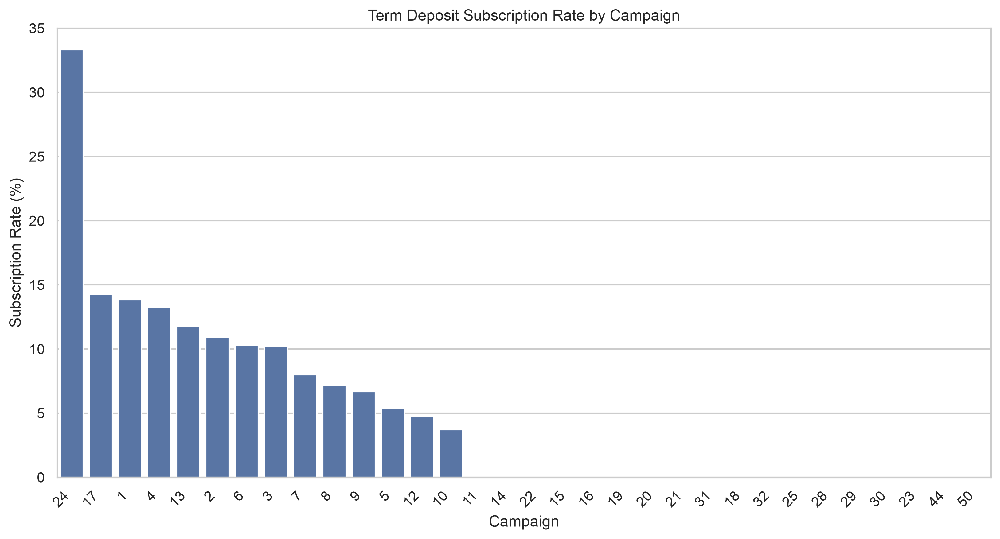

## 5. Numerical Feature Analysis vs Subscription

Numerical features were compared between subscribers and non-subscribers using descriptive statistics and boxplots.

The analysis suggests:
- Subscribers have a higher average age than non-subscribers in this dataset.
- Subscriber balances show a higher median than non-subscriber balances.
- Campaign contact history shows differences between the two target groups.
- Pdays and previous contact history may contain useful information.
- Age and contact day show relatively similar distributions between the groups.

**Figure: Numerical Features vs Subscription**

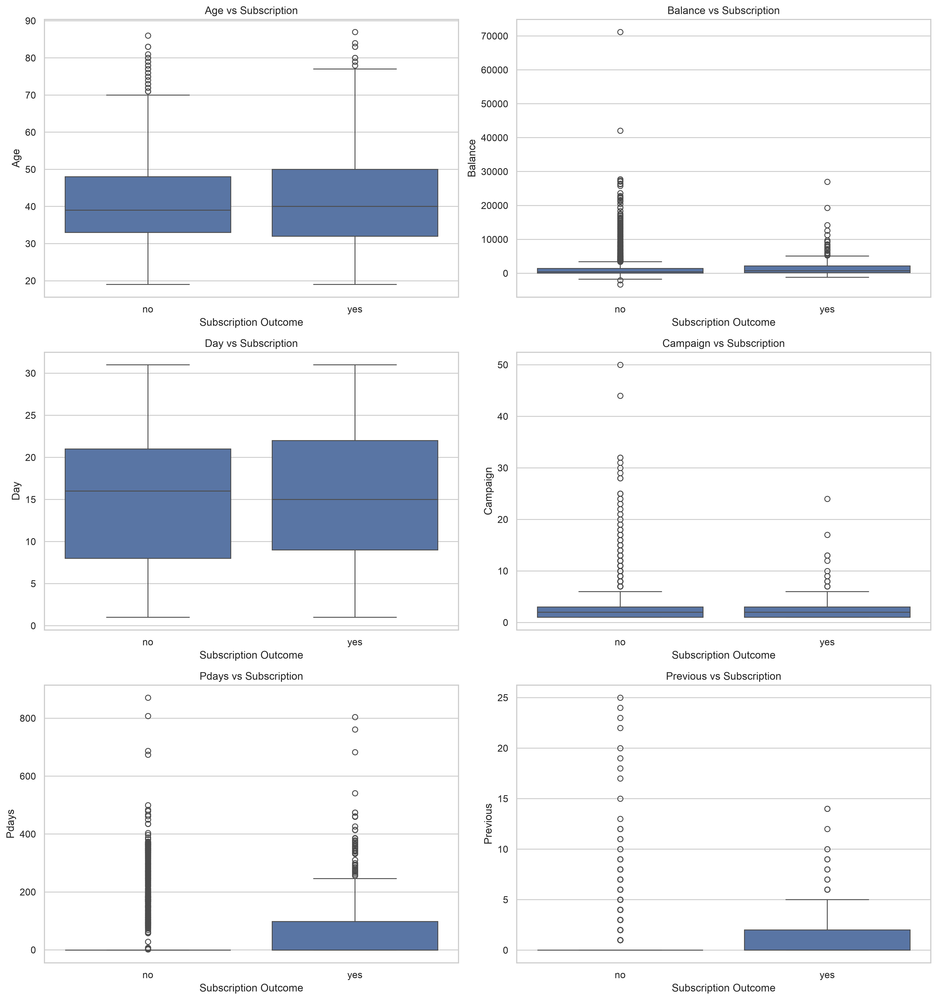

These are exploratory observations. Their predictive usefulness must be assessed during model development.

## 6. Correlation Analysis

The numerical correlation analysis found that:
- Most numerical feature pairs have weak linear correlations close to zero.
- The strongest observed relationship is between `pdays` and `previous`, approximately 0.58.
- No pair of numerical predictors shows an extremely strong linear correlation.

**Figure: Numerical Correlation Heatmap**

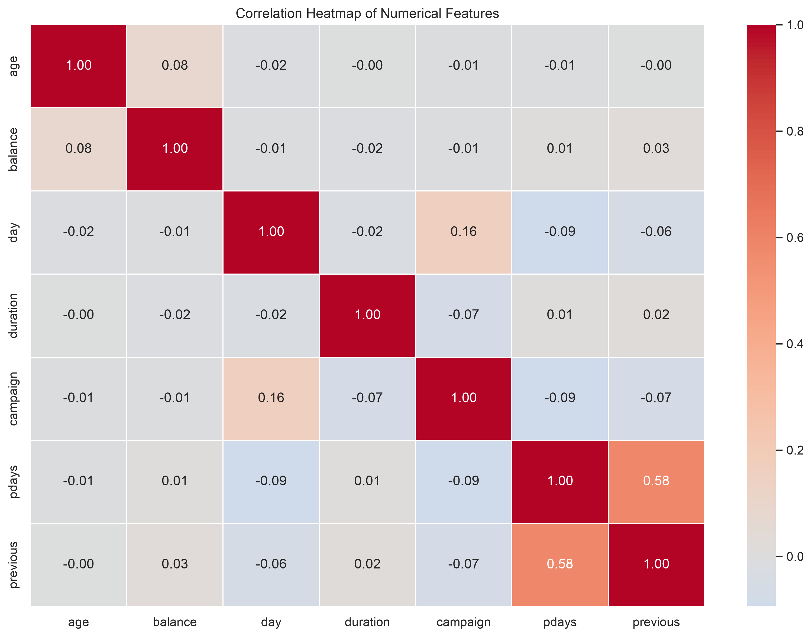

Correlation does not imply causation. Weak pairwise correlation also does not mean a feature is unimportant for prediction.

## 7. Data Leakage Consideration

The `duration` feature represents the length of the last contact. It is only known after the customer call ends.

For a model intended to predict subscription before contacting the customer, using duration would introduce potential target leakage.

Therefore, duration is included in exploratory analysis but excluded from pre-call model inputs.

## 8. Class Imbalance

Only 11.52% of customers subscribed to a term deposit, while 88.48% did not.

This imbalance must be considered during model development. Possible strategies include:
- Class-weighted learning.
- Random oversampling.
- SMOTE applied only to training data.

Resampling must not be performed on validation or test data. Model evaluation should consider minority-class performance rather than accuracy alone.

## 9. Business Insights

The exploratory analysis identifies several potentially useful customer segments and characteristics:

1. Retired and student customers show relatively high observed subscription rates.
2. Tertiary-educated customers show a higher observed subscription rate than other education groups.
3. Customers without housing or personal loans show higher observed subscription rates.
4. Subscription rates vary considerably across contact months.
5. Previous campaign success has a strong observed association with subscription.
6. Customer balance and campaign history may provide useful information for predictive modelling.

These observations represent associations in the dataset and do not establish causation.

## 10. Conclusion

The EDA identified potentially informative customer and campaign characteristics, including job, education, marital status, loan status, contact month and previous campaign outcome.

The numerical analysis also highlighted skewed distributions, statistical outliers and the special interpretation required for `pdays = -1`.

The target variable is imbalanced, and duration must be excluded from pre-call prediction to avoid potential leakage.

These findings will guide feature engineering, preprocessing and model development. Predictive usefulness will be assessed through appropriate validation and evaluation techniques.

## 11. Figures Directory

All generated EDA figures are stored in:

`images/eda/`

The analysis contains 14 generated figures covering target distribution, numerical distributions, boxplots, correlation, job distribution and subscription-rate comparisons.
