# BANK MARKETING SUBSCRIPTION PREDICTION USING MACHINE LEARNING

## 1. Abstract

The banking industry uses direct marketing campaigns, including telephone calls, to promote financial products such as term deposits. However, contacting customers who are unlikely to subscribe can increase operational costs and reduce campaign efficiency. Identifying potential subscribers before initiating marketing calls can help banks prioritize their customer outreach activities.

This project, **Bank Marketing Subscription Prediction**, develops a machine learning-based classification system to predict whether a customer is likely to subscribe to a term deposit. The project uses a bank marketing dataset containing 4,521 customer records and 17 original attributes, including demographic information, financial details, and previous marketing campaign information.

The problem is formulated as a supervised binary classification task, where the target variable indicates whether a customer subscribed to the term deposit (`yes`) or did not subscribe (`no`). The preprocessing workflow includes data preparation, categorical feature encoding, numerical feature scaling, and handling class imbalance using Synthetic Minority Over-sampling Technique for Nominal and Continuous features (SMOTENC). The `duration` attribute is excluded from model development because it is known only after a call has ended and could introduce target leakage in a pre-call prediction scenario.

Five classification algorithms were evaluated: Logistic Regression, Decision Tree, Random Forest, Support Vector Machine (SVM), and Gradient Boosting. Gradient Boosting was selected as the final model based on comparative validation performance. A complete machine learning pipeline was developed using SMOTENC, StandardScaler, OneHotEncoder, and GradientBoostingClassifier.

In the final reproducible validation workflow, the selected model achieved an F1-score of 0.3128 at the default classification threshold of 0.50 and 0.3333 at the selected threshold of 0.7419. The model achieved a ROC-AUC of 0.7171 and a PR-AUC of 0.3211. Five-fold stratified cross-validation was also performed to examine model stability.

Finally, the trained model was packaged and integrated into a Streamlit web application supporting individual customer predictions, batch predictions, model performance visualization, and business insights. The application is intended to support marketing decisions by helping prioritize potential subscribers rather than replacing human decision-making.

**Keywords:** Machine Learning, Bank Marketing, Binary Classification, Gradient Boosting, SMOTENC, Customer Subscription Prediction, Streamlit, Predictive Analytics.

---

## 2. Introduction

### 2.1 Background

The banking and financial services industry uses various marketing strategies to promote financial products and services. One such product is a term deposit, in which customers deposit money for a specified period in exchange for an agreed return.

Banks frequently conduct direct marketing campaigns through telephone calls and other communication channels to encourage customers to subscribe to these products. The effectiveness of these campaigns depends on several factors, including customer characteristics, financial background, communication methods, and previous interactions with the bank.

Traditional marketing campaigns may involve contacting a large number of customers without accurately identifying their likelihood of subscribing. This can result in unnecessary communication efforts, increased operational costs, and inefficient allocation of marketing resources.

Machine learning provides an opportunity to analyze historical customer data and identify patterns associated with subscription decisions. By learning from previous marketing outcomes, classification models can estimate the probability that a customer will subscribe to a term deposit.

### 2.2 Project Overview

The Bank Marketing Subscription Prediction project applies machine learning techniques to historical bank marketing data to predict customer subscription outcomes.

The system analyzes multiple customer attributes, including:

- Age and occupation.
- Marital status and education.
- Account balance and financial indicators.
- Housing loan and personal loan information.
- Communication channel and campaign details.
- Previous marketing campaign outcomes.

Based on these attributes, the trained model estimates the probability of a customer subscribing to a term deposit.

The project follows an end-to-end machine learning workflow, beginning with dataset understanding and preprocessing, followed by exploratory data analysis, feature engineering, model development, evaluation, model packaging, and deployment through a Streamlit application.

### 2.3 Role of Machine Learning in Banking Marketing

Machine learning can support banking marketing activities by identifying patterns in historical customer behavior and providing data-driven predictions.

In this project, binary classification is used to distinguish between two possible outcomes:

- **Yes:** The customer subscribed to the term deposit.
- **No:** The customer did not subscribe to the term deposit.

The predicted subscription probability can help marketing teams prioritize customer outreach. However, model predictions represent estimates based on historical patterns and should be interpreted as decision-support information rather than guaranteed outcomes.

### 2.4 Motivation

The motivation behind this project is to demonstrate how machine learning can be applied to a practical banking problem.

The project focuses on the following challenges:

1. Marketing campaigns may involve contacting customers who are unlikely to subscribe.
2. Customer subscription decisions depend on multiple demographic, financial, and campaign-related factors.
3. The historical dataset contains an imbalanced target distribution, making model evaluation more challenging.
4. Different classification algorithms may produce different prediction results.
5. Model predictions need to be presented through an accessible application for practical use.

The project addresses these challenges by developing a complete machine learning pipeline and integrating the selected model into an interactive web application.

### 2.5 Scope of the Project

The scope of this project includes:

- Understanding and analyzing historical bank marketing data.
- Performing data preprocessing and exploratory data analysis.
- Selecting relevant customer attributes for prediction.
- Handling class imbalance using SMOTENC.
- Developing and comparing five classification algorithms.
- Evaluating model performance using multiple classification metrics.
- Generating individual and batch customer predictions.
- Presenting model results and business insights through a Streamlit application.

The project is designed as an academic machine learning application and demonstrates the complete development workflow from raw data to an interactive prediction system.

---

## 3. Problem Statement

### 3.1 Problem Definition

Banking institutions conduct direct marketing campaigns to promote financial products such as term deposits. These campaigns often involve contacting customers through telephone calls. However, not every contacted customer is interested in subscribing to the offered product.

When marketing teams contact customers without effectively identifying their likelihood of subscription, valuable time and resources may be spent on unsuccessful interactions. This can reduce campaign efficiency and increase operational costs.

The main problem addressed in this project is the identification of potential term deposit subscribers using historical customer and marketing campaign information.

The project aims to develop a machine learning classification model that analyzes customer attributes and predicts whether a customer is likely to subscribe to a term deposit.

### 3.2 Formal Problem Definition

The problem is formulated as a supervised binary classification task.

Let:

- `X` represent the input features describing a customer.
- `y` represent the target variable indicating subscription outcome.

The target variable has two possible classes:

- y = 1: Customer subscribes (Yes).
- y = 0: Customer does not subscribe (No).

The objective is to develop a classification function:

**f(X) = P(y = 1 | X)**

The model estimates the probability of subscription based on the available customer attributes. A decision threshold is then applied to convert the predicted probability into a binary classification.

### 3.3 Challenges Addressed

The project addresses the following technical and business challenges:

1. **Class Imbalance:** The dataset contains significantly more non-subscribers than subscribers, which can affect the ability of classification models to identify the minority class.

2. **Mixed Data Types:** The dataset contains numerical and categorical attributes that require appropriate preprocessing before model training.

3. **Feature Relevance:** Not every available attribute is suitable for prediction before a marketing call. The `duration` feature is excluded because it represents call duration and is only known after the call ends.

4. **Model Selection:** Multiple classification algorithms must be evaluated to identify a suitable model for the prediction task.

5. **Evaluation:** Accuracy alone is insufficient for evaluating an imbalanced classification problem. Precision, recall, F1-score, ROC-AUC and PR-AUC are also considered.

6. **Practical Accessibility:** The trained model must be integrated into an accessible application that supports individual and batch predictions.

### 3.4 Expected Outcome

The expected outcome is an end-to-end machine learning system that:

- Accepts customer information as input.
- Estimates the probability of term deposit subscription.
- Classifies customers into predicted subscription categories.
- Supports batch processing of customer records.
- Provides model performance information and business insights.
- Helps marketing teams prioritize customer outreach.

The system is intended to provide predictive decision support. Actual customer subscription decisions cannot be guaranteed by the model.

---

## 4. Objectives

### 4.1 Primary Objective

To design and develop a machine learning-based prediction system that identifies customers who are more likely to subscribe to a bank term deposit using historical bank marketing data.

### 4.2 Specific Objectives

The specific objectives of the project are:

1. **Dataset Understanding:** Study the bank marketing dataset, understand its attributes, identify the target variable and examine the distribution of customer records.

2. **Data Preprocessing:** Prepare the dataset by validating data quality, handling categorical and numerical variables, and excluding features that could introduce target leakage.

3. **Exploratory Data Analysis:** Analyze customer characteristics, subscription patterns, numerical distributions, categorical relationships and correlations through visualizations.

4. **Feature Engineering:** Identify relevant numerical and categorical predictors and prepare them for machine learning algorithms.

5. **Class Imbalance Handling:** Apply SMOTENC to address the imbalance between subscribers and non-subscribers within the training pipeline.

6. **Model Development:** Implement and compare Logistic Regression, Decision Tree, Random Forest, Support Vector Machine and Gradient Boosting classifiers.

7. **Model Evaluation:** Evaluate the classification models using Accuracy, Precision, Recall, F1-score, ROC-AUC and PR-AUC.

8. **Threshold Analysis:** Investigate classification thresholds to understand the trade-off between identifying potential subscribers and reducing false positive predictions.

9. **Model Packaging:** Save the selected trained pipeline and its metadata to support reproducibility and reuse.

10. **Application Development:** Develop a Streamlit application that provides individual customer prediction, batch prediction, model performance visualization and business insights.

11. **Business Interpretation:** Analyze feature importance and customer subscription patterns to derive data-driven marketing recommendations.

12. **Project Documentation:** Document the complete machine learning lifecycle, implementation methodology, evaluation findings, limitations and future improvements.

### 4.3 Project Deliverables

The expected project deliverables include:

- Cleaned and processed dataset.
- Seven Jupyter notebooks covering the machine learning workflow.
- Data preprocessing and feature engineering implementation.
- Model comparison and evaluation results.
- Trained Gradient Boosting pipeline.
- Model metadata and reusable Python scripts.
- Streamlit prediction application.
- Business insights and visualization reports.
- Final project report and presentation.

---

## 5. Literature Review

### 5.1 Introduction

Machine learning has become an important approach for analyzing customer behavior and supporting data-driven decision-making in banking and financial services. Predictive models can use historical customer information and previous marketing interactions to estimate the likelihood of a customer responding positively to a marketing campaign.

Bank telemarketing subscription prediction is a classification problem in which the objective is to identify customers who are likely to subscribe to a term deposit. Several research studies have investigated this problem using statistical learning, classification algorithms and ensemble methods.

This section reviews relevant research and explains how the existing studies relate to the proposed project.

### 5.2 Review of Existing Research

#### 5.2.1 Moro, Cortez and Rita (2014)

**Research Paper:** A Data-Driven Approach to Predict the Success of Bank Telemarketing.

**Published In:** Decision Support Systems, Volume 62, 2014, Pages 22–31.

This research presents a data mining approach for predicting the success of bank telemarketing campaigns promoting long-term deposits. The authors studied data from a Portuguese retail bank and investigated customer, product and socioeconomic characteristics.

The study explored feature selection and compared four data mining models: Logistic Regression, Decision Trees, Neural Networks and Support Vector Machines. It also considered a rolling-window evaluation strategy to examine model performance over time.

The research demonstrated the importance of predictive analytics for improving customer targeting and supporting marketing decision-making.

**Relevance to the proposed project:** This study provides the foundational research context for the Bank Marketing Subscription Prediction project. It establishes the application of machine learning to predicting term deposit subscription outcomes.

#### 5.2.2 Peter et al. (2025)

**Research Paper:** Predicting Customer Subscription in Bank Telemarketing Campaigns Using Ensemble Learning Models.

**Published In:** Machine Learning with Applications, Volume 19, March 2025, Article 100618.

This study investigates ensemble learning approaches, including bagging, boosting and stacking, for predicting customer subscriptions in bank telemarketing campaigns.

The research considers class imbalance and complex customer behavior while comparing different ensemble approaches. Its findings report that the stacking model achieved the strongest overall performance in the experiments, with an accuracy of 91.88% and ROC-AUC of 0.9491.

The study also discusses the importance of customer engagement and economic indicators in predicting subscription outcomes.

**Relevance to the proposed project:** This research supports the investigation of ensemble learning methods for bank marketing prediction. It provides a useful comparison with the Gradient Boosting classifier implemented in this project, although the datasets and experimental configurations are not identical.

#### 5.2.3 2025 IEEE Study on Imbalanced Bank Marketing Data

**Research Paper:** A Data-Driven Approach for Predicting Term Deposit Subscriptions While Handling Missing and Extremely Imbalanced Bank Telemarketing Data.

**Published In:** 2025 20th International Joint Symposium on Artificial Intelligence and Natural Language Processing (iSAI-NLP).

This research investigates prediction of term deposit subscriptions using a larger bank marketing dataset containing 41,188 records.

The study compares different combinations of classification algorithms, missing-value imputation methods and data resampling techniques. It evaluates 48 model configurations involving methods such as Support Vector Classifier, Random Forest, XGBoost, SMOTE and other sampling approaches.

The reported results identify a Support Vector Classifier combined with SMOTE and MICE imputation as the best-performing configuration in that study.

**Relevance to the proposed project:** This research highlights the importance of addressing class imbalance and evaluating different preprocessing and resampling strategies. It supports the decision to investigate imbalance handling as part of the proposed machine learning pipeline.

### 5.3 Comparative Summary of Literature

| Research | Main approach | Important contribution |
|---|---|---|
| Moro et al. (2014) | Logistic Regression, Decision Trees, Neural Networks and SVM | Foundational bank telemarketing prediction research |
| Peter et al. (2025) | Bagging, Boosting and Stacking | Investigates ensemble learning for subscription prediction |
| IEEE Study (2025) | SVC, Random Forest, XGBoost and resampling methods | Investigates class imbalance and missing-value handling |

The studies demonstrate that bank marketing subscription prediction can be approached using multiple machine learning algorithms. They also highlight the importance of model selection, class imbalance handling and appropriate evaluation strategies.

### 5.4 Research Gap and Project Motivation

The reviewed studies demonstrate the potential of machine learning for predicting bank term deposit subscriptions. However, their experimental datasets, feature configurations, algorithms and evaluation strategies differ.

This project focuses on developing a complete and reproducible machine learning workflow using the smaller `bank.csv` dataset containing 4,521 customer records.

The project emphasizes:

- Comparing five classification algorithms using a consistent evaluation framework.
- Handling mixed numerical and categorical data.
- Applying SMOTENC within the training pipeline.
- Excluding call duration to support prediction before the call takes place.
- Evaluating classification performance using multiple metrics suitable for imbalanced data.
- Integrating the selected model into a practical Streamlit application.

Rather than claiming a new classification algorithm, the project demonstrates the practical implementation and integration of established machine learning techniques into an end-to-end banking prediction system.

### 5.5 Literature Review Conclusion

The reviewed research establishes a strong foundation for applying machine learning to bank marketing subscription prediction. Existing studies demonstrate the usefulness of classification algorithms, ensemble learning and data resampling techniques.

Based on these findings, the proposed project implements and evaluates multiple classification algorithms, selects Gradient Boosting through comparative validation, and develops an interactive application for customer subscription prediction.

## 6. Dataset Description

### 6.1 Dataset Source

The dataset used in this project is the Bank Marketing dataset obtained from the UCI Machine Learning Repository. It contains information about customers contacted during a bank's direct marketing campaign and records whether each customer subscribed to the offered term deposit.

This project uses the smaller `bank.csv` variant containing 4,521 customer records and 17 columns. It is important to distinguish this dataset from the separate `bank-additional-full.csv` dataset, which contains a larger number of records and a different set of attributes.

**Dataset source:** Moro, S., Rita, P., & Cortez, P. (2014). Bank Marketing [Dataset]. UCI Machine Learning Repository. https://doi.org/10.24432/C5K306

### 6.2 Dataset Overview

The main dataset contains 4,521 rows and 17 columns, including 16 input attributes and one target variable.

| Property | Description |
|---|---|
| Dataset name | Bank Marketing |
| Source | UCI Machine Learning Repository |
| File used | `bank.csv` |
| Number of records | 4,521 |
| Total columns | 17 |
| Input attributes | 16 |
| Target variable | `y` |
| Problem type | Binary classification |
| Delimiter | Semicolon (`;`) |

An additional file named `test.csv` contains 427 records with 17 columns. It does not contain the target variable and is used for generating subscription predictions through the trained model.

### 6.3 Dataset Attributes

The dataset contains demographic information, financial details, campaign contact information and previous campaign outcomes.

The attributes are described below.

| Attribute | Description | Data Type |
|---|---|---|
| age | Age of the customer | Numerical |
| job | Type of occupation | Categorical |
| marital | Marital status | Categorical |
| education | Education level | Categorical |
| default | Whether the customer has credit in default | Categorical |
| balance | Average yearly account balance | Numerical |
| housing | Whether the customer has a housing loan | Categorical |
| loan | Whether the customer has a personal loan | Categorical |
| contact | Type of communication contact | Categorical |
| day | Last contact day of the month | Numerical |
| month | Last contact month | Categorical |
| duration | Last contact duration in seconds | Numerical |
| campaign | Number of contacts performed during the current campaign | Numerical |
| pdays | Number of days since the customer was previously contacted | Numerical |
| previous | Number of contacts performed before the current campaign | Numerical |
| poutcome | Outcome of the previous marketing campaign | Categorical |
| y | Whether the customer subscribed to a term deposit | Categorical |

### 6.4 Target Variable Distribution

The target variable is `y`, which indicates whether a customer subscribed to the term deposit.

It contains two classes:

- `yes`: Customer subscribed to the term deposit.
- `no`: Customer did not subscribe to the term deposit.

The distribution in the dataset is:

| Target Class | Number of Records | Percentage |
|---|---:|---:|
| No | 4,000 | 88.48% |
| Yes | 521 | 11.52% |
| **Total** | **4,521** | **100%** |

The dataset is imbalanced because the number of customers who did not subscribe is considerably higher than the number who subscribed. This imbalance is considered during preprocessing, model training and evaluation.

### 6.5 Dataset Selection Justification

The Bank Marketing dataset was selected because it represents a practical banking business problem and contains a mixture of numerical and categorical customer attributes.

It provides an opportunity to study customer characteristics, perform exploratory data analysis, compare classification algorithms and develop a predictive application.

The dataset is also publicly available, making the project reproducible and suitable for academic experimentation.

---

## 7. Methodology

### 7.1 Overall Project Workflow

The project follows a structured machine learning lifecycle, beginning with business problem understanding and ending with application deployment.

The major stages are:

1. Business problem identification.
2. Dataset collection and understanding.
3. Data preprocessing and quality checks.
4. Exploratory Data Analysis.
5. Feature engineering and feature selection.
6. Model development and comparison.
7. Model evaluation and threshold selection.
8. Model packaging and saving.
9. Business insight generation.
10. Streamlit application development.
11. Testing and documentation.

### 7.2 Problem Formulation

The task is formulated as a supervised binary classification problem.

Let:

- `X` represent the customer input features.
- `y` represent the subscription outcome.
- \(y=1\) indicate subscription (`yes`).
- \(y=0\) indicate non-subscription (`no`).

The objective is to develop a model that estimates the probability of a customer subscribing to a term deposit:

\[
P(y = 1 | X)
\]

The model uses customer and campaign information to estimate this probability. A decision threshold is then applied to classify customers into subscription and non-subscription categories.

### 7.3 Training and Validation Strategy

The labelled dataset contains 4,521 records. It was divided into training and validation subsets using an 80:20 stratified split.

| Subset | Number of Records |
|---|---:|
| Training | 3,616 |
| Validation | 905 |
| Total | 4,521 |

Stratification preserves approximately the same target-class proportions in both subsets.

The split uses `random_state=42` to support reproducibility.

The validation subset is used for comparing model performance and selecting the classification threshold.

### 7.4 Handling Class Imbalance

The target variable contains substantially more non-subscribers than subscribers. Training directly on this distribution may cause a model to favour the majority class.

To address this issue, the project uses **SMOTENC (Synthetic Minority Over-sampling Technique for Nominal and Continuous features)**.

SMOTENC is designed for datasets containing both numerical and categorical variables. It generates synthetic minority-class observations while considering the mixed feature types.

The sampling operation is included inside the machine learning pipeline so that it is applied during model fitting rather than to the complete dataset before splitting.

### 7.5 Model Selection

Five classification algorithms were compared using a consistent evaluation framework:

1. Logistic Regression
2. Decision Tree
3. Random Forest
4. Gradient Boosting
5. Support Vector Machine (SVM)

The models were evaluated using metrics appropriate for imbalanced binary classification, including precision, recall, F1-score, ROC-AUC and PR-AUC.

Gradient Boosting was selected as the final model based on the project's comparative evaluation and validation results.

### 7.6 Final Machine Learning Pipeline

The final model uses an integrated preprocessing and classification pipeline.

The main stages are:

**Stage 1 — SMOTENC:** Handles class imbalance during training.

**Stage 2 — ColumnTransformer:** Applies different preprocessing operations to numerical and categorical columns.

**Stage 3 — Numerical preprocessing:** StandardScaler is applied to numerical features.

**Stage 4 — Categorical preprocessing:** OneHotEncoder converts categorical features into numerical representations. The encoder uses `handle_unknown="ignore"` to handle previously unseen categories during prediction.

**Stage 5 — Gradient Boosting:** The processed features are passed to the selected classification algorithm.

The pipeline ensures that preprocessing and prediction operations remain consistent between model training and application usage.

### 7.7 Threshold Selection

A classification threshold determines how predicted probabilities are converted into final classes.

The default threshold of 0.50 was compared with alternative thresholds using validation results.

The project selected a threshold of 0.7419 based on the threshold analysis performed during model evaluation.

A higher threshold reduces the number of customers classified as potential subscribers, but it can also increase the number of actual subscribers missed by the model.

The selected threshold is stored in the model metadata and used by the application.

---

## 8. Data Preprocessing

### 8.1 Data Loading

The dataset was loaded into Python using the Pandas library.

The primary `bank.csv` file uses a semicolon delimiter, whereas the additional `test.csv` file uses a comma delimiter. Therefore, the appropriate delimiter was specified while loading each file.

The initial dataset contained 4,521 labelled records and 17 columns.

### 8.2 Data Inspection

Initial inspection was performed to understand the dataset structure and identify potential data-quality issues.

The following operations were used:

- Checking the number of rows and columns.
- Inspecting column names and data types.
- Viewing sample records.
- Examining numerical summary statistics.
- Checking target-class distribution.
- Identifying missing values and duplicate records.
- Inspecting categorical values and unusual entries.

These checks helped establish the dataset's structure before further processing.

### 8.3 Missing Values and Duplicate Records

The dataset was examined for missing values and duplicate records.

No missing values or duplicate records were identified in the main labelled dataset during the project analysis.

The categorical value `unknown` was retained as an explicit category rather than automatically treating it as a missing value. This preserves information about cases where a customer attribute was not recorded.

### 8.4 Handling Special Values

The `pdays` attribute contains the value `-1` for customers who were not previously contacted during an earlier campaign.

This value represents a specific campaign condition rather than an ordinary negative number. It was retained in the dataset so that the model could use this information.

### 8.5 Target Encoding

The target variable `y` contains the categories `yes` and `no`.

For binary classification, these categories were converted into numerical labels:

| Original Value | Encoded Value |
|---|---:|
| no | 0 |
| yes | 1 |

This conversion allows the classification algorithms and evaluation functions to work with a numerical target.

### 8.6 Exclusion of the Duration Feature

The `duration` attribute represents the duration of the last contact with the customer, measured in seconds.

Although this attribute may contain useful predictive information, its value is known only after the call has ended. Including it in a model intended to support decisions before contacting a customer would introduce information that is unavailable at prediction time.

For this reason, `duration` was excluded from the final model.

This decision helps align the model with the intended business use case: estimating subscription likelihood using information available before the marketing call.

### 8.7 Final Feature Selection

After excluding the target variable and `duration`, the final model uses 15 input features.

**Numerical features (6):**

1. age
2. balance
3. day
4. campaign
5. pdays
6. previous

**Categorical features (9):**

1. job
2. marital
3. education
4. default
5. housing
6. loan
7. contact
8. month
9. poutcome

The selected features represent customer demographics, financial characteristics and marketing campaign history.

### 8.8 Numerical Feature Preprocessing

Numerical features are processed using `StandardScaler`.

Standardization transforms numerical values to a common scale based on their mean and standard deviation.

This helps prevent differences in numerical ranges from dominating algorithms that are sensitive to feature scale.

The scaler is fitted as part of the training pipeline and reused during prediction.

### 8.9 Categorical Feature Preprocessing

Categorical features are transformed using `OneHotEncoder`.

One-hot encoding creates numerical indicator columns for categorical values, allowing machine learning algorithms to process non-numerical attributes.

The encoder is configured with `handle_unknown="ignore"` so that an unseen category in new input data does not cause the prediction process to fail.

### 8.10 Preprocessing Pipeline and Leakage Prevention

The preprocessing operations are integrated into an imbalanced-learn pipeline.

SMOTENC and the preprocessing transformations are fitted using training data within the model-training process. During cross-validation, the pipeline ensures that sampling is performed within the respective training folds rather than before the folds are created.

During prediction, the already-fitted preprocessing transformations are reused. The sampler is not applied to new prediction records.

This approach helps maintain consistency between training and inference and reduces the risk of data leakage during model validation.

### 8.11 Final Preprocessed Dataset

The final modelling dataset contains:

- 4,521 labelled customer records.
- 15 selected input features.
- One binary target variable.
- Six numerical features.
- Nine categorical features.
- No `duration` feature.

The resulting data is prepared for feature engineering, model development and comparative evaluation.

## 9. Exploratory Data Analysis (EDA)

### 9.1 Introduction

Exploratory Data Analysis (EDA) was performed to understand the structure, distribution and relationships within the Bank Marketing dataset.

The main objectives were to identify patterns in customer characteristics, examine differences between subscribers and non-subscribers, understand the distribution of numerical and categorical features, and identify potentially useful variables for predictive modelling.

The analysis was performed on the labelled dataset containing 4,521 customer records and 17 columns.

Python libraries such as Pandas, Matplotlib and Seaborn were used for data analysis and visualization.

### 9.2 Target Variable Distribution

The first step was to examine the distribution of the target variable `y`.

The dataset contains two subscription outcomes:

| Subscription Outcome | Number of Customers | Percentage |
|---|---:|---:|
| No | 4,000 | 88.48% |
| Yes | 521 | 11.52% |
| **Total** | **4,521** | **100%** |

The analysis shows that non-subscribers represent 88.48% of the dataset, whereas subscribers represent only 11.52%.

<figure class="report-figure">
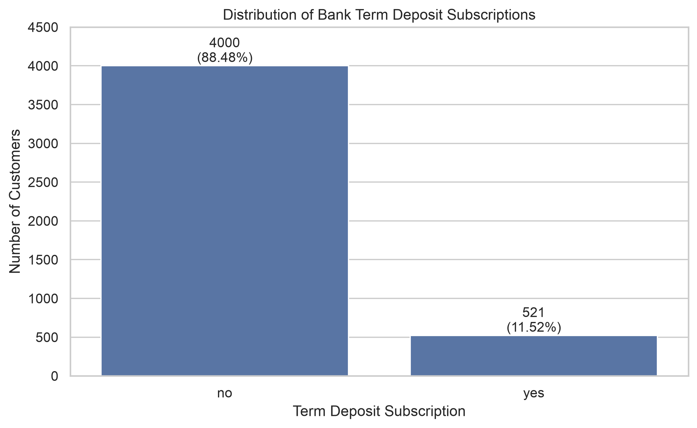
<figcaption>Figure 9.1: Target Variable Distribution</figcaption>
</figure>

This confirms that the dataset is imbalanced. Consequently, accuracy alone may not provide a complete picture of classification performance. Metrics such as precision, recall, F1-score and PR-AUC are also important when evaluating the model.

### 9.3 Analysis of Numerical Features

The numerical features investigated during EDA were:

- Age
- Balance
- Day
- Duration
- Campaign
- Pdays
- Previous

The distributions and statistical characteristics of these variables were examined using descriptive statistics, distribution plots and boxplots.

#### 9.3.1 Age Distribution

The age distribution shows that customer records are concentrated around middle-age groups.

<figure class="report-figure">
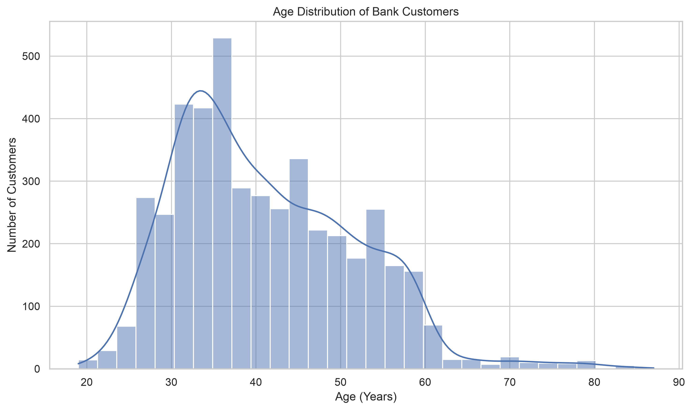
<figcaption>Figure 9.2: Customer Age Distribution</figcaption>
</figure>

Age may provide useful demographic information for understanding differences in subscription behaviour.

#### 9.3.2 Numerical Feature Boxplots

Boxplots were used to examine the spread of numerical features and identify potential statistical outliers.

<figure class="report-figure">
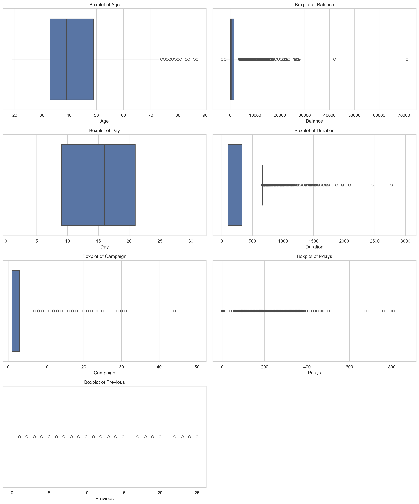
<figcaption>Figure 9.3: Boxplots of Numerical Features</figcaption>
</figure>

The following observations were identified:

1. Balance has a highly dispersed distribution and contains extreme values.
2. Campaign includes observations with relatively high contact counts.
3. Pdays contains many `-1` values, indicating customers who were not previously contacted.
4. Previous is concentrated around zero because many customers have no previous campaign contacts.
5. Statistical outliers do not necessarily represent invalid records and should not automatically be removed.

Negative account balances were also retained because they may represent legitimate overdrafts.

### 9.4 Analysis of Categorical Features

Categorical analysis was performed to understand customer distribution across different categories and compare observed subscription rates.

The features investigated included job, education, marital status, housing loan, personal loan, contact month and previous campaign outcome.

#### 9.4.1 Job Category Analysis

The job distribution shows that management has the largest customer count, with 969 records, followed by blue-collar with 946 and technician with 768.

The observed subscription rates differ across job categories:

- Retired customers have the highest observed subscription rate at 23.48%.
- Students have an observed subscription rate of 22.62%.
- Blue-collar customers have the lowest observed subscription rate at 7.29%.

<figure class="report-figure">
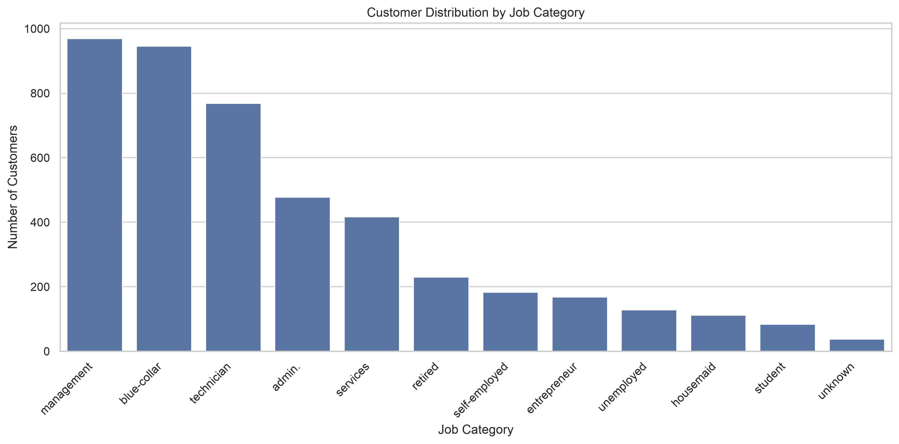
<figcaption>Figure 9.4: Customer Distribution by Job Category</figcaption>
</figure>

<figure class="report-figure">
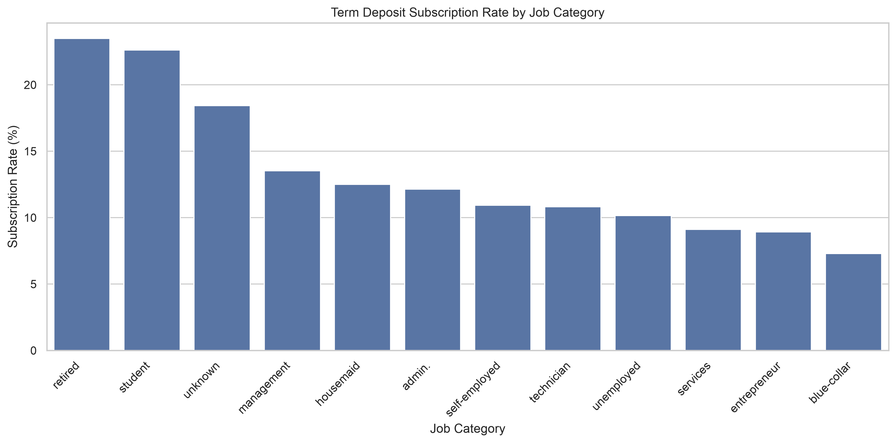
<figcaption>Figure 9.5: Subscription Rate by Job Category</figcaption>
</figure>

These differences suggest that job category may provide useful information for understanding customer subscription patterns.

#### 9.4.2 Education Analysis

The subscription rates across education categories are:

| Education | Customers | Subscribers | Subscription Rate |
|---|---:|---:|---:|
| Tertiary | 1,350 | 193 | 14.30% |
| Secondary | 2,306 | 245 | 10.62% |
| Unknown | 187 | 19 | 10.16% |
| Primary | 678 | 64 | 9.44% |

Tertiary-educated customers show the highest observed subscription rate among the education categories.

<figure class="report-figure">
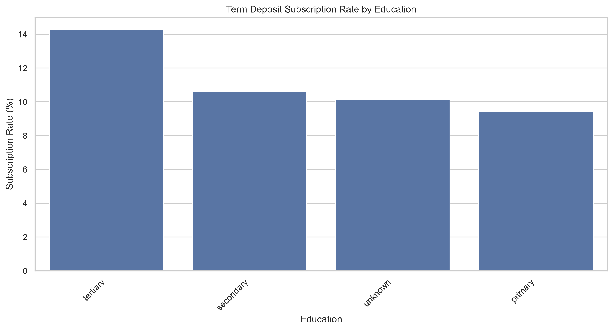
<figcaption>Figure 9.6: Subscription Rate by Education</figcaption>
</figure>

#### 9.4.3 Marital Status Analysis

The observed subscription rates across marital-status categories are:

| Marital Status | Customers | Subscribers | Subscription Rate |
|---|---:|---:|---:|
| Divorced | 528 | 77 | 14.58% |
| Single | 1,196 | 167 | 13.96% |
| Married | 2,797 | 277 | 9.90% |

Divorced and single customers show higher observed subscription rates than married customers in this dataset.

<figure class="report-figure">
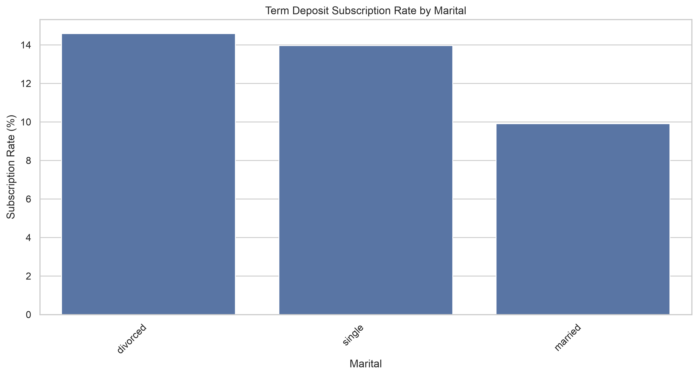
<figcaption>Figure 9.7: Subscription Rate by Marital Status</figcaption>
</figure>

#### 9.4.4 Housing Loan Analysis

The subscription rates based on housing-loan status are:

| Housing Loan | Customers | Subscribers | Subscription Rate |
|---|---:|---:|---:|
| No | 1,962 | 301 | 15.34% |
| Yes | 2,559 | 220 | 8.60% |

Customers without a housing loan show a higher observed subscription rate than customers with a housing loan.

<figure class="report-figure">
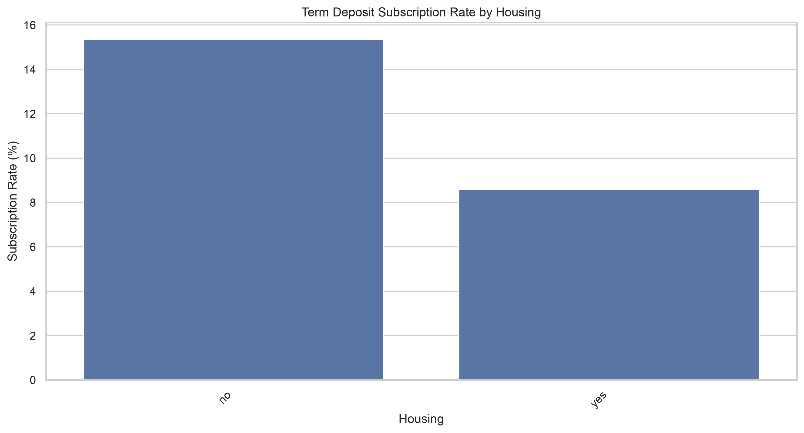
<figcaption>Figure 9.8: Subscription Rate by Housing Loan Status</figcaption>
</figure>

#### 9.4.5 Personal Loan Analysis

The observed subscription rates based on personal-loan status are:

| Personal Loan | Customers | Subscribers | Subscription Rate |
|---|---:|---:|---:|
| No | 3,830 | 478 | 12.48% |
| Yes | 691 | 43 | 6.22% |

Customers without a personal loan show a higher observed subscription rate in the dataset.

<figure class="report-figure">
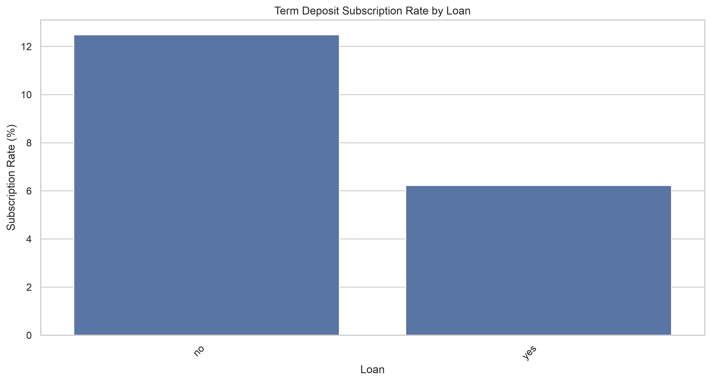
<figcaption>Figure 9.9: Subscription Rate by Personal Loan Status</figcaption>
</figure>

#### 9.4.6 Contact Month Analysis

Subscription rates were also compared across the months in which customers were contacted.

October, December and March show the highest observed subscription rates, while May has the lowest observed rate at 6.65%.

However, some months contain relatively small sample sizes. Therefore, the differences should be interpreted cautiously.

<figure class="report-figure">
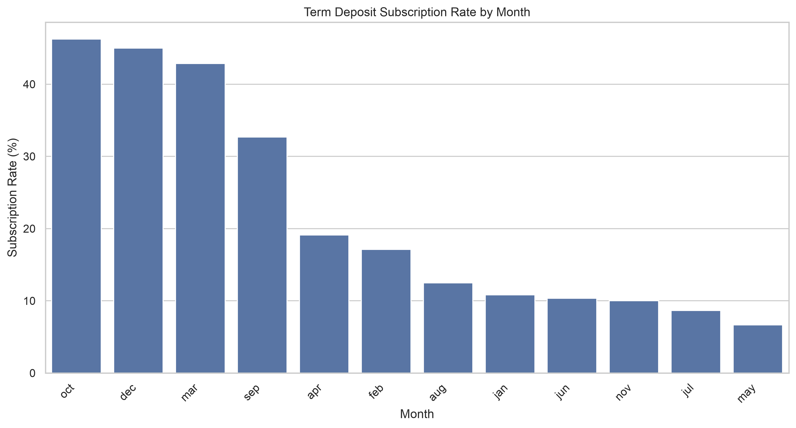
<figcaption>Figure 9.10: Subscription Rate by Contact Month</figcaption>
</figure>

#### 9.4.7 Previous Campaign Outcome Analysis

The previous campaign outcome provides information about the results of earlier marketing interactions.

The observed subscription rates are:

| Previous Outcome | Customers | Subscribers | Subscription Rate |
|---|---:|---:|---:|
| Success | 129 | 83 | 64.34% |
| Other | 197 | 38 | 19.29% |
| Failure | 490 | 63 | 12.86% |
| Unknown | 3,705 | 337 | 9.10% |

Customers with a previous successful campaign outcome have a substantially higher observed subscription rate than the other categories.

<figure class="report-figure">
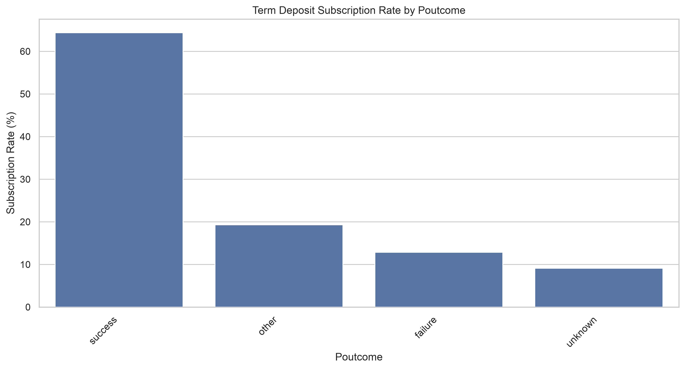
<figcaption>Figure 9.11: Subscription Rate by Previous Campaign Outcome</figcaption>
</figure>

This suggests that previous campaign history may be an informative predictor.

#### 9.4.8 Campaign Contact Analysis

The number of contacts made during the current campaign was also examined.

The highest observed subscription rate occurs at campaign value 24. However, this category contains only three customers.

Higher campaign contact counts generally have small sample sizes, so their observed subscription rates should not be treated as reliable general trends.

<figure class="report-figure">
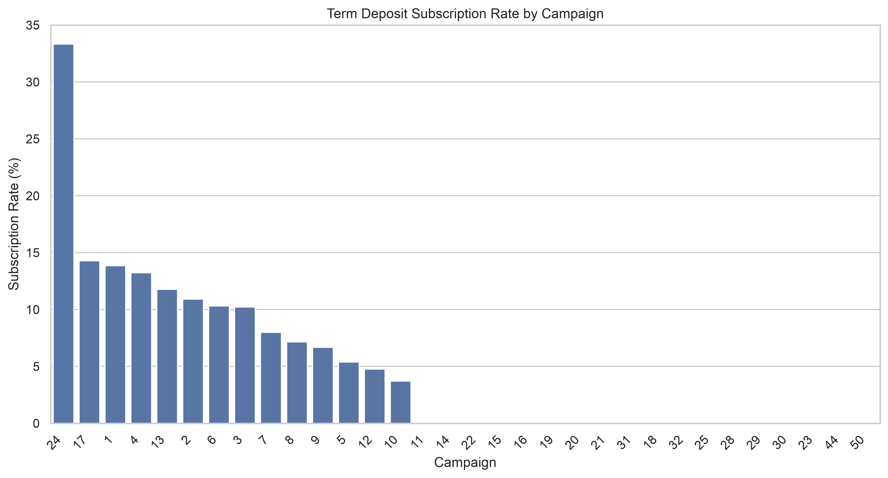
<figcaption>Figure 9.12: Subscription Rate by Campaign Contacts</figcaption>
</figure>

### 9.5 Numerical Features vs Subscription Outcome

Numerical features were compared between customers who subscribed and those who did not.

The analysis produced the following observations:

- Subscribers have a higher average age than non-subscribers in this dataset.
- Subscriber balances show a higher median than non-subscriber balances.
- Campaign contact history shows differences between the two target groups.
- Pdays and previous contact history may contain useful predictive information.
- Age and contact day show relatively similar distributions between the groups.

<figure class="report-figure">
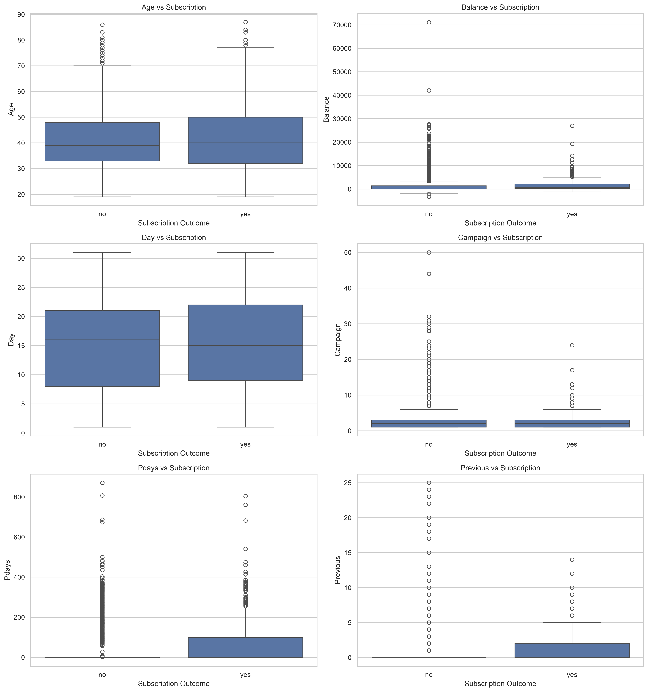
<figcaption>Figure 9.13: Numerical Features Compared with Subscription Outcome</figcaption>
</figure>

These observations are exploratory findings. The actual predictive usefulness of the features must be assessed through model development and validation.

### 9.6 Correlation Analysis

Correlation analysis was performed to examine linear relationships between numerical features.

The numerical correlation heatmap shows that most feature pairs have relatively weak linear correlations close to zero.

The strongest observed relationship is between `pdays` and `previous`, with a correlation of approximately 0.58.

No pair of numerical predictors shows an extremely strong linear correlation in the analysis.

<figure class="report-figure">
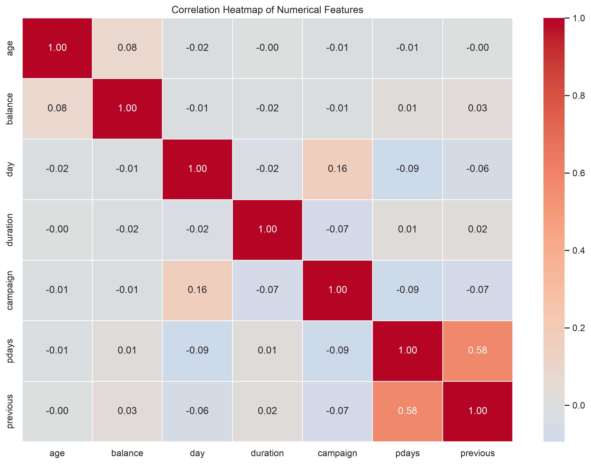
<figcaption>Figure 9.14: Numerical Feature Correlation Heatmap</figcaption>
</figure>

Correlation analysis helps identify linear relationships between variables. However, correlation does not imply causation. A feature with weak pairwise correlation may still provide useful information to a machine learning model.

### 9.7 Data Leakage Consideration

During EDA, the `duration` feature was also investigated.

Duration represents the length of the last customer contact in seconds. However, this information becomes available only after the call has ended.

Since the intended application is designed to estimate subscription likelihood before contacting a customer, using duration as an input would introduce potential target leakage.

Therefore, duration was retained for exploratory analysis but excluded from the final model's input features.

### 9.8 Impact of Class Imbalance on Analysis

The target distribution indicates that only 11.52% of customers subscribed, while 88.48% did not.

This imbalance is important because a model that frequently predicts the majority class may achieve apparently high accuracy while failing to identify a sufficient number of actual subscribers.

The analysis therefore supports the use of appropriate imbalance-handling methods during training and evaluation metrics that measure minority-class performance.

The project subsequently uses SMOTENC within the training pipeline. Resampling is not applied to validation or prediction data.

### 9.9 Key Findings from EDA

The major findings from the exploratory analysis are summarized below:

| No. | Finding | Observation |
|---:|---|---|
| 1 | Target imbalance | Only 11.52% of customers subscribed. |
| 2 | Job category | Retired and student customers show relatively high observed subscription rates. |
| 3 | Education | Tertiary-educated customers show a 14.30% subscription rate. |
| 4 | Marital status | Divorced and single customers show higher observed rates than married customers. |
| 5 | Loan status | Customers without housing or personal loans show higher observed subscription rates. |
| 6 | Contact month | Subscription rates vary across contact months. |
| 7 | Previous outcome | Previous campaign success has a 64.34% observed subscription rate. |
| 8 | Numerical features | Balance and campaign history show potentially useful patterns. |
| 9 | Correlation | The strongest observed numerical correlation is approximately 0.58 between `pdays` and `previous`. |
| 10 | Duration | Excluded from pre-call prediction because it is known only after the call. |

These findings helped guide feature selection, preprocessing and subsequent model development.

### 9.10 Conclusion

The exploratory data analysis provided an understanding of customer demographics, financial characteristics and marketing campaign history.

The analysis identified differences in observed subscription rates across job, education, marital status, loan status, contact month and previous campaign outcome.

It also highlighted numerical distributions containing extreme values, the special interpretation required for `pdays = -1`, and the imbalance in the target variable.

The analysis confirmed the importance of excluding duration from pre-call prediction to avoid potential target leakage.

Overall, EDA provided the foundation for feature engineering and model development. However, the observed relationships are associations within the dataset and do not establish causal relationships.

## 10. Feature Engineering and Feature Selection

### 10.1 Introduction

Feature engineering and feature selection are important stages in machine learning. Feature engineering involves creating or transforming variables to represent useful information, while feature selection identifies the input variables that contribute to predictive performance.

In this project, feature engineering was performed to investigate whether additional customer and campaign-related variables could improve the prediction of term-deposit subscriptions.

The experiments were conducted using the Bank Marketing dataset containing 4,521 observations. A stratified 80:20 training-validation split was used, consisting of 3,616 training records and 905 validation records, with `random_state=42`.

The `duration` feature was excluded because it is unavailable before the customer call ends and could introduce target leakage.

### 10.2 Objectives of Feature Engineering

The main objectives were:

1. Investigate additional features that may represent customer characteristics and campaign history.
2. Identify potentially useful predictors of subscription.
3. Examine correlations and redundancy between features.
4. Compare different feature-selection techniques.
5. Evaluate alternative feature sets using validation metrics.
6. Maintain proper separation between training and validation data to prevent leakage.

### 10.3 Candidate Engineered Features

Five candidate features were investigated during this phase.

| No. | Engineered Feature | Purpose |
|---:|---|---|
| 1 | `age_group` | Represents customer age in grouped categories. |
| 2 | `balance_group` | Represents account balance using grouped categories. |
| 3 | `has_previous_contact` | Indicates whether the customer was previously contacted. |
| 4 | `total_contacts` | Represents combined contact history. |
| 5 | `campaign_intensity` | Investigates campaign contact intensity. |

The original features were retained for comparison with the engineered features.

Balance thresholds were learned using training data only. This helped prevent information from the validation dataset from influencing the feature-engineering process.

### 10.4 Feature Selection Techniques

Multiple feature-selection and feature-analysis techniques were investigated.

#### 10.4.1 Pearson Correlation Analysis

Pearson correlation was used to examine linear relationships between numerical features.

It helped identify variables that contained overlapping information and could potentially introduce redundancy.

#### 10.4.2 Mutual Information

Mutual Information (MI) was used to estimate how much information a feature provides about the target variable.

Unlike simple linear correlation, Mutual Information can identify certain non-linear statistical relationships.

The highest-ranked features were:

| Feature | MI Score |
|---|---:|
| `pdays` | 0.0634 |
| `poutcome` | 0.0262 |
| `month` | 0.0221 |
| `previous` | 0.0144 |
| `age` | 0.0113 |

The results indicate that previous campaign history and contact-related variables contain potentially useful information for predicting subscription.

Mutual Information was used as a screening technique rather than the sole basis for removing features.

<figure class="report-figure">
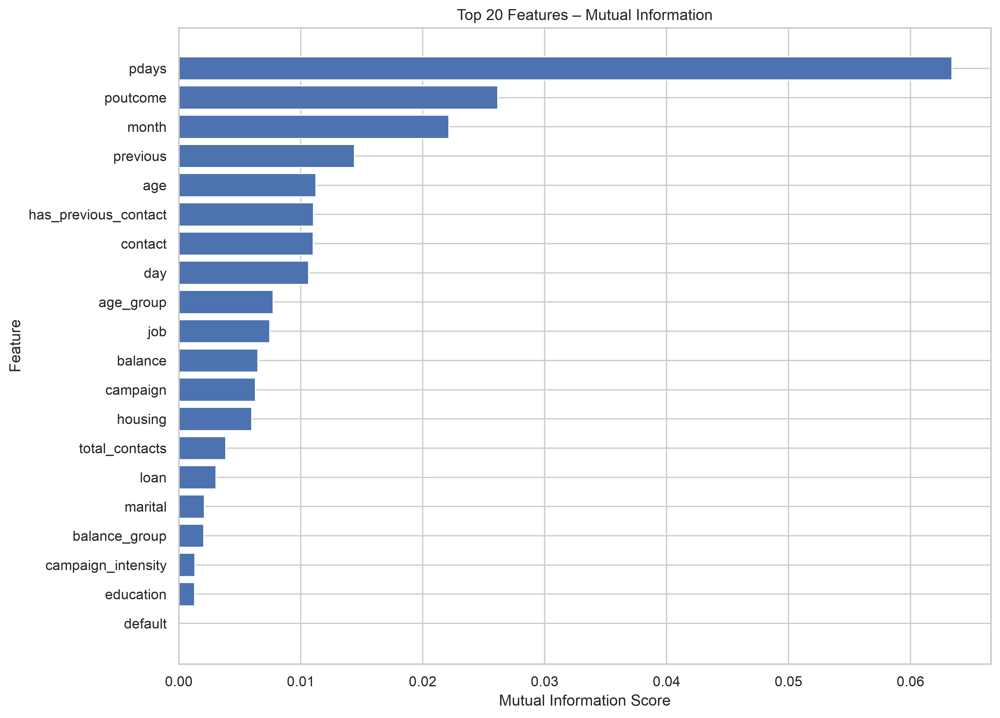
<figcaption>Figure 10.1: Mutual Information Feature Ranking</figcaption>
</figure>

#### 10.4.3 Random Forest Feature Importance

Random Forest impurity-based importance was used to examine the relative contribution of features within a Random Forest model.

The leading features were:

| Feature | Importance |
|---|---:|
| `balance` | 0.1059 |
| `age` | 0.0917 |
| `day` | 0.0887 |
| `total_contacts` | 0.0402 |
| `campaign` | 0.0363 |

Balance, age and day received the highest importance values among the listed features.

Impurity-based importance was interpreted cautiously because it can be influenced by feature characteristics and the structure of the fitted model.

<figure class="report-figure">
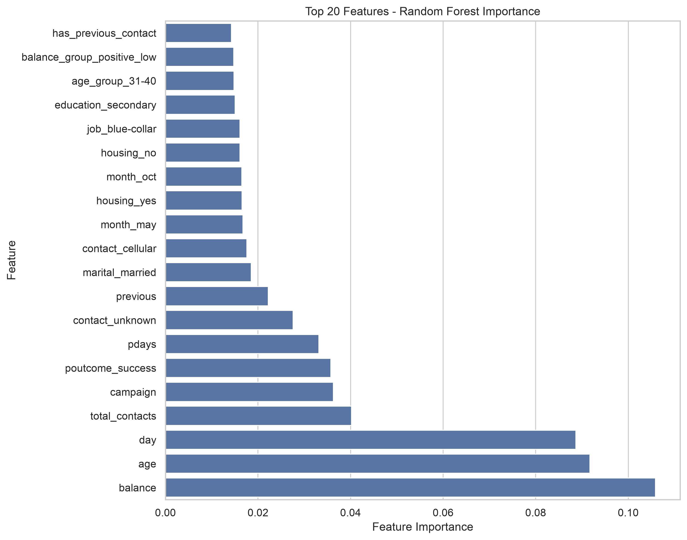
<figcaption>Figure 10.2: Random Forest Feature Importance</figcaption>
</figure>

#### 10.4.4 Permutation Importance

Permutation importance was used to evaluate how much model performance changed when the values of an individual feature were randomly shuffled.

The analysis used validation Average Precision (PR-AUC) as the performance measure.

The leading features were:

| Feature | Mean Importance |
|---|---:|
| `poutcome_success` | 0.069804 |
| `poutcome_unknown` | 0.011802 |
| `pdays` | 0.010793 |
| `month_may` | 0.010385 |
| `previous` | 0.008307 |

The results highlight the importance of previous campaign outcomes and contact history in the evaluated model.

<figure class="report-figure">
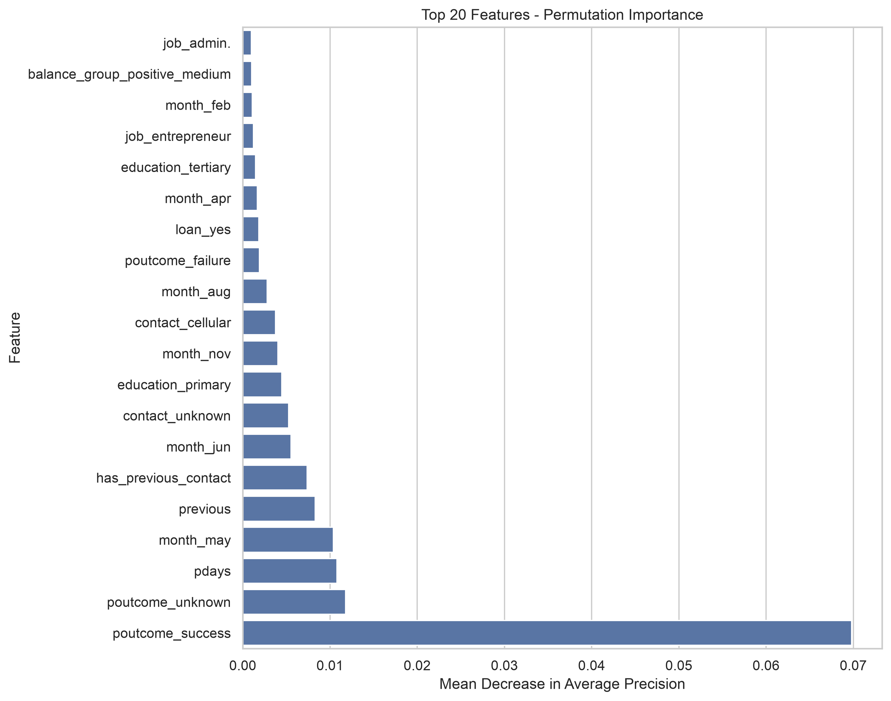
<figcaption>Figure 10.3: Permutation Feature Importance</figcaption>
</figure>

### 10.5 Feature Correlation and Redundancy Analysis

Correlation analysis was also performed to identify engineered features that contained information similar to existing variables.

Two highly correlated feature pairs were identified:

| Feature Pair | Correlation |
|---|---:|
| `campaign` and `total_contacts` | 0.8771 |
| `pdays` and `has_previous_contact` | 0.8638 |

The results indicate substantial overlap between these feature pairs.

For example, `total_contacts` contains information related to campaign contact history, while `has_previous_contact` is closely related to the information represented by `pdays`.

<figure class="report-figure">
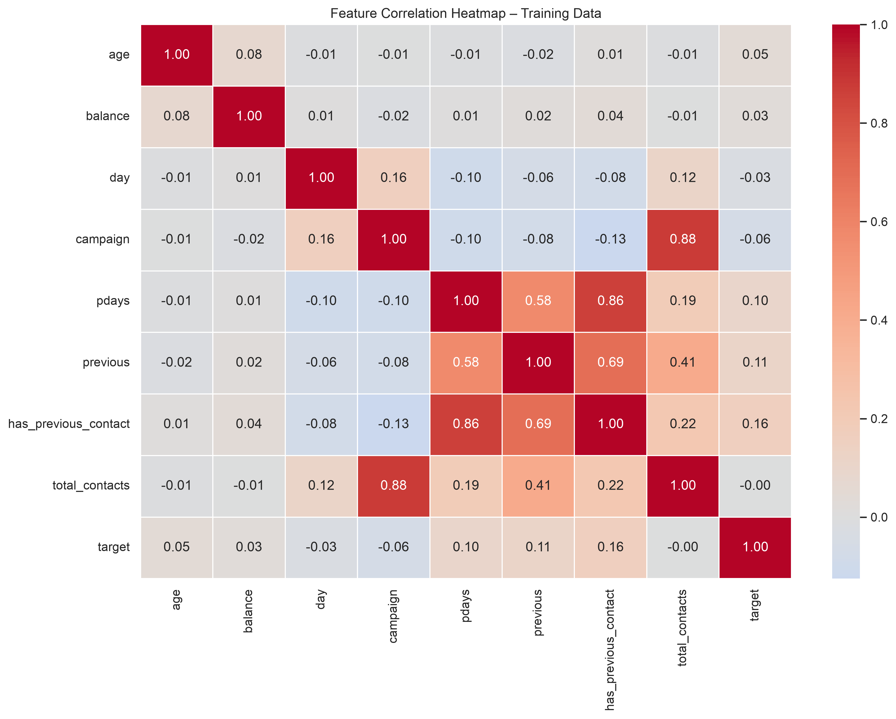
<figcaption>Figure 10.4: Feature Correlation Analysis</figcaption>
</figure>

No automatic feature removal was performed based only on these correlations. The features were retained as candidates for further comparative evaluation.

### 10.6 Feature-Set Comparison

To understand the effect of engineered features and potential redundancy, four Random Forest experiments were conducted using different feature configurations.

The experiments were evaluated using PR-AUC, recall and F1-score.

| Experiment | Feature Configuration | PR-AUC | Recall | F1-Score |
|---|---|---:|---:|---:|
| A | Full features | 0.3387 | 0.4327 | 0.3571 |
| B | Without `total_contacts` | 0.3432 | 0.4231 | 0.3492 |
| C | Without `has_previous_contact` | 0.3385 | 0.4519 | 0.3643 |
| D | Without both engineered features | 0.3397 | 0.5000 | 0.3969 |

The experiments produced different performance trade-offs:

- Experiment B achieved the highest PR-AUC of 0.3432.
- Experiment D achieved the highest recall of 0.5000.
- Experiment D also achieved the highest F1-score of 0.3969.
- The differences between the configurations were relatively small.

These results demonstrate that the preferred feature configuration depends on the evaluation objective.

### 10.7 Feature Selection Decision

The experiments did not establish a single final feature set solely on the basis of feature engineering results.

The four feature configurations remained candidates for further evaluation during subsequent model development and comparison.

Therefore, the results of this phase were used as supporting evidence rather than as the final decision for selecting model inputs.

The final model configuration was determined through the subsequent modelling and validation process.

### 10.8 Data Leakage Prevention

Several precautions were followed during feature engineering and feature selection:

1. The `duration` feature was excluded from predictive inputs because it is known only after the call.
2. The target variable `y` was never included as a model input.
3. Balance-group thresholds were derived from training data only.
4. Encoders and model pipelines were fitted using training data.
5. Validation data was kept separate during feature-selection fitting.
6. Validation Average Precision was used for permutation-importance evaluation.
7. Feature configurations were compared using the validation dataset.

These practices helped reduce the risk of information leakage during the experiments.

### 10.9 Business Insights from Feature Engineering

The feature-engineering experiments provided several useful observations:

- Previous campaign outcomes, particularly `poutcome`, provide useful predictive information.
- Contact history features such as `pdays` and `previous` contribute useful information.
- Customer age and account balance also contribute to identifying differences in subscription behaviour.
- Campaign-related features may contain overlapping information.
- The best feature configuration depends on whether the objective is to improve PR-AUC, recall or F1-score.

These findings can help guide customer segmentation and marketing decision-support strategies. However, feature importance and statistical relationships do not establish causation.

### 10.10 Conclusion

This phase investigated five candidate engineered features and applied multiple feature-selection techniques to identify potentially useful predictors of bank marketing subscription.

Pearson correlation, Mutual Information, Random Forest impurity-based importance, permutation importance and controlled feature-set comparisons were used to study feature relevance and redundancy.

The experiments identified highly correlated feature pairs and demonstrated different trade-offs between PR-AUC, recall and F1-score.

No final feature set was approved solely from these experiments. The findings were carried forward to model development and comparative validation, where the final model configuration was selected.

Overall, feature engineering provided a systematic way to investigate additional information, understand feature relationships and support the development of the final predictive model.

## 11. Model Development

### 11.1 Introduction

Model development is a major stage of the machine learning lifecycle. After understanding the dataset, performing preprocessing and investigating useful features, multiple classification algorithms were implemented and evaluated.

The objective of this phase was to identify a suitable classification model for predicting whether a customer would subscribe to a bank term deposit.

Five machine learning algorithms were compared using a consistent training and evaluation framework. Gradient Boosting was selected as the final model based on its comparative validation and cross-validation results.

### 11.2 Model Development Environment

The project was implemented using Python and Scikit-learn, along with the imbalanced-learn library for handling class imbalance.

The main libraries and tools used were:

| Library / Tool | Purpose |
|---|---|
| Python | Main programming language |
| Pandas | Dataset handling and analysis |
| NumPy | Numerical operations |
| Scikit-learn | Machine learning algorithms and evaluation |
| imbalanced-learn | SMOTENC and imbalanced-learn pipelines |
| Joblib | Saving and loading the trained model |
| Matplotlib and Seaborn | Model evaluation visualizations |

The experiments used a stratified 80:20 training-validation split with `random_state=42`.

### 11.3 Classification Algorithms

Five classification algorithms were implemented and compared.

#### 11.3.1 Logistic Regression

Logistic Regression is a supervised classification algorithm that estimates the probability of a binary outcome.

It uses the logistic function to convert a linear combination of input features into a probability between zero and one.

In this project, Logistic Regression was included as a baseline classification model for comparing the performance of more complex algorithms.

#### 11.3.2 Decision Tree

A Decision Tree is a supervised learning algorithm that makes predictions using a sequence of feature-based decision rules.

It divides the dataset into smaller groups using selected conditions and produces a prediction at the terminal nodes.

Decision Trees are easy to interpret, but an unrestricted tree may overfit the training data.

#### 11.3.3 Random Forest

Random Forest is an ensemble learning algorithm that combines predictions from multiple decision trees.

Each tree is trained using a different sample and feature selection process. The combined predictions generally provide a more stable result than relying on a single decision tree.

Random Forest was included to evaluate the performance of a tree-based ensemble method.

#### 11.3.4 Support Vector Machine (SVM)

Support Vector Machine is a supervised learning algorithm that identifies a decision boundary separating different classes.

The project investigated an SVM using the Radial Basis Function (RBF) kernel.

SVM was included to compare a margin-based classification approach with linear and tree-based algorithms.

#### 11.3.5 Gradient Boosting

Gradient Boosting is an ensemble learning algorithm that builds multiple decision trees sequentially.

Each new tree attempts to correct errors made by the existing ensemble by optimizing a loss function through gradient-based learning.

The final prediction combines the contributions of the individual trees.

Gradient Boosting was selected as the final model after comparative evaluation.

### 11.4 Model Comparison Framework

All five algorithms were evaluated using a consistent framework.

The experiments included baseline and tuned model configurations. Their performance was compared using:

- Accuracy
- Precision
- Recall
- F1-score
- ROC-AUC
- PR-AUC

PR-AUC was particularly important because the dataset contains a relatively small proportion of subscribers.

The following table presents the tuned validation results recorded in the project's model comparison report.

| Model | Accuracy | Precision | Recall | F1-Score | ROC-AUC | PR-AUC |
|---|---:|---:|---:|---:|---:|---:|
| Logistic Regression | 0.6707 | 0.1891 | 0.5673 | 0.2837 | 0.6882 | 0.2901 |
| Decision Tree | 0.6519 | 0.1754 | 0.5481 | 0.2657 | 0.6673 | 0.2380 |
| Random Forest | 0.6961 | 0.2082 | 0.5865 | 0.3073 | 0.7022 | 0.2997 |
| SVM | 0.5890 | 0.1763 | 0.7019 | 0.2819 | 0.6905 | 0.2492 |
| Gradient Boosting | 0.7282 | 0.2205 | 0.5385 | 0.3128 | 0.7171 | 0.3211 |

Gradient Boosting achieved the highest accuracy, F1-score, ROC-AUC and PR-AUC among the tuned models in this comparison.

Random Forest achieved a higher recall of 0.5865, while SVM achieved the highest recall of 0.7019. However, their PR-AUC values were lower than that of Gradient Boosting.

<figure class="report-figure">
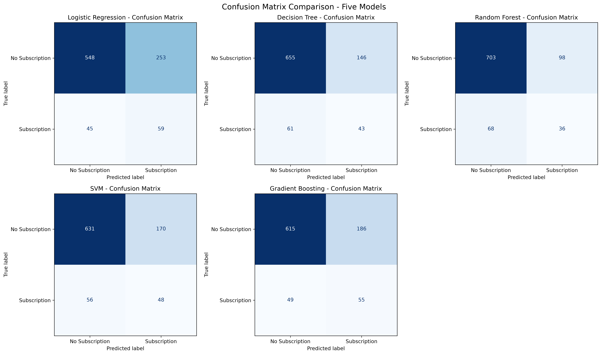
<figcaption>Figure 11.1: Comparison of Five Classification Models</figcaption>
</figure>

<figure class="report-figure">
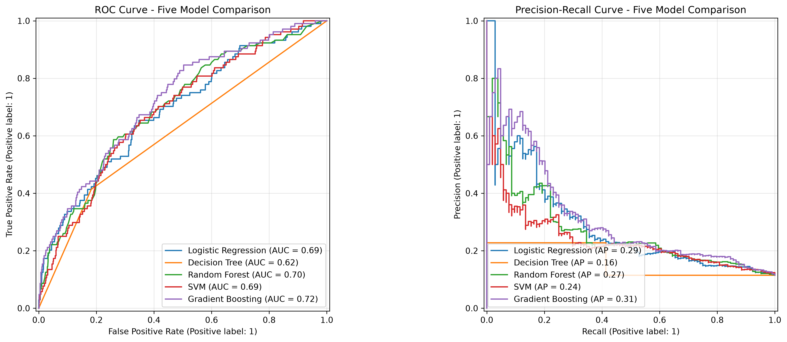
<figcaption>Figure 11.2: ROC and Precision-Recall Curve Comparison</figcaption>
</figure>

### 11.5 Hyperparameter Tuning

Hyperparameter tuning was performed to identify suitable configurations for the classification algorithms.

Hyperparameters are settings specified before model training that influence how an algorithm learns from data.

For the selected Gradient Boosting model, the final configuration was:

| Hyperparameter | Selected Value |
|---|---:|
| `learning_rate` | 0.07027897634919636 |
| `max_depth` | 2 |
| `min_samples_leaf` | 2 |
| `min_samples_split` | 13 |
| `n_estimators` | 207 |
| `subsample` | 0.8 |
| `random_state` | 42 |

These settings control the learning rate, complexity of individual trees, minimum observations required for splitting and leaf nodes, number of boosting stages and proportion of training samples used during each boosting stage.

The recorded Gradient Boosting tuning time was approximately 69.403 seconds.

The best cross-validation PR-AUC recorded for this model was 0.3202.

### 11.6 Five-Fold Cross-Validation

Five-fold cross-validation was used to examine the stability of the selected model across different training and validation folds.

In this method, the training data is divided into five subsets. The model is trained using four subsets and evaluated on the remaining subset. This process is repeated until each subset has been used for validation.

The selected Gradient Boosting model achieved the following cross-validation results:

| Metric | Mean | Standard Deviation |
|---|---:|---:|
| Accuracy | 0.7411 | 0.0157 |
| Precision | 0.2233 | 0.0085 |
| Recall | 0.5039 | 0.0715 |
| F1-score | 0.3085 | 0.0192 |
| ROC-AUC | 0.7103 | 0.0292 |
| PR-AUC | 0.3202 | 0.0352 |

The cross-validation results provide an estimate of model performance across multiple data splits.

The standard deviations indicate the amount of variation observed between folds. In particular, recall shows greater variation than accuracy, indicating that minority-class identification is more sensitive to the validation split.

### 11.7 Selection of the Final Model

Gradient Boosting was selected as the final model based on its comparative performance.

The main reasons for selecting it were:

1. It achieved the highest tuned validation PR-AUC of 0.3211.
2. It achieved the highest tuned validation F1-score of 0.3128.
3. It achieved the highest tuned validation ROC-AUC of 0.7171.
4. It achieved the highest tuned validation accuracy of 0.7282.
5. Its five-fold cross-validation PR-AUC was 0.3202 ± 0.0352.

Although Random Forest and SVM achieved higher recall, Gradient Boosting provided the strongest PR-AUC and F1-score among the tuned models in the recorded comparison.

Therefore, Gradient Boosting was selected as the final classification algorithm.

### 11.8 Final Model Pipeline

The selected classifier was integrated into an imbalanced-learn pipeline.

The pipeline consists of the following stages:

1. **SMOTENC:** Generates synthetic minority-class observations during training while considering numerical and categorical features.
2. **ColumnTransformer:** Applies the appropriate transformations to different feature groups.
3. **StandardScaler:** Standardizes numerical features.
4. **OneHotEncoder:** Converts categorical variables into numerical representations.
5. **GradientBoostingClassifier:** Produces the final subscription probability.

The pipeline ensures that the same fitted preprocessing operations are applied during prediction.

SMOTENC is used during model fitting and is not applied to new customer records during inference.

### 11.9 Final Model Training

The final training procedure follows two stages.

**Stage 1: Validation model**

The dataset was divided into training and validation subsets using stratified sampling.

The selected Gradient Boosting configuration was fitted on the training subset. Predictions were generated for the validation subset to calculate performance metrics and examine the decision threshold.

**Stage 2: Final model retraining**

After the validation evaluation, a new pipeline using the selected hyperparameters was fitted on the complete labelled dataset containing 4,521 records.

This final training step allows the packaged model to use all available labelled observations.

The validation metrics remain separate from this final full-data fitting process.

### 11.10 Model Packaging and Saving

After final training, the complete pipeline was saved using Joblib.

The following files were generated:

| File | Purpose |
|---|---|
| `models/best_model.joblib` | Stores the fitted preprocessing and classification pipeline. |
| `models/model_metadata.json` | Stores model configuration and metadata. |
| `reports/evaluation_results.json` | Stores validation evaluation results. |

The metadata contains information such as:

- Model name and model type.
- Random state.
- Decision threshold.
- Selected input features.
- Numerical and categorical feature lists.
- Excluded feature information.
- Preprocessing operations.
- Selected hyperparameters.
- Training dataset size.
- Validation dataset size.
- Model artifact location.
- Training timestamp.

Saving the complete pipeline ensures that the application can load the trained model without independently rebuilding its preprocessing steps.

### 11.11 Reproducibility

Several practices were followed to improve reproducibility:

1. A fixed random state of 42 was used for the train-validation split and model configuration.
2. The selected Gradient Boosting hyperparameters were explicitly recorded.
3. Preprocessing and classification operations were packaged together.
4. The trained pipeline was saved as a Joblib artifact.
5. Model metadata and evaluation results were stored separately.
6. The training process was implemented in `src/train.py`.

These practices make it easier to reproduce the model-training workflow and use the same model configuration in the Streamlit application.

### 11.12 Conclusion

This phase implemented and compared five machine learning classification algorithms for predicting bank term-deposit subscriptions.

The comparison included Logistic Regression, Decision Tree, Random Forest, Support Vector Machine and Gradient Boosting.

Based on the recorded tuned validation results, Gradient Boosting achieved the highest PR-AUC, F1-score and ROC-AUC among the five models.

The selected model was integrated with SMOTENC and the preprocessing transformations into a single pipeline. It was subsequently retrained using all 4,521 labelled records and saved as a reusable Joblib artifact.

The completed model pipeline forms the foundation for the detailed evaluation, threshold analysis and Streamlit application described in the following chapters.

## 12. Model Evaluation and Validation

### 12.1 Introduction

Model evaluation is an essential stage of machine learning because it measures how effectively a trained model performs on data that was not used for fitting that model.

In this project, the selected Gradient Boosting classifier was evaluated using a stratified validation dataset containing 905 customer records.

The evaluation focused on classification performance, minority-class identification, probability ranking, cross-validation stability and the effect of changing the classification threshold.

Since the target variable is imbalanced, multiple evaluation metrics were considered instead of relying only on accuracy.

### 12.2 Evaluation Dataset

The labelled dataset was divided into training and validation subsets using stratified sampling.

| Property | Value |
|---|---:|
| Total labelled records | 4,521 |
| Training records | 3,616 |
| Validation records | 905 |
| Actual non-subscribers in validation | 801 |
| Actual subscribers in validation | 104 |
| Random state | 42 |

The validation dataset represents approximately 20% of the original labelled dataset.

The model was trained using the training subset and evaluated on the validation subset.

### 12.3 Evaluation Metrics

The following metrics were used to evaluate the selected classification model.

#### 12.3.1 Accuracy

Accuracy measures the proportion of all predictions that are correct.

\[
Accuracy = (TP + TN) / (TP + TN + FP + FN)
\]

It provides an overall measure of classification correctness. However, accuracy can be misleading when one target class is much larger than the other.

#### 12.3.2 Precision

Precision measures the proportion of predicted subscribers who actually subscribed.

\[
Precision = TP / (TP + FP)
\]

Higher precision means fewer non-subscribers are incorrectly identified as potential subscribers.

#### 12.3.3 Recall

Recall measures the proportion of actual subscribers correctly identified by the model.

\[
Recall = TP / (TP + FN)
\]

Higher recall means the model identifies more of the customers who actually subscribed.

#### 12.3.4 F1-Score

F1-score is the harmonic mean of precision and recall.

\[
F1 = 2 × (Precision × Recall) / (Precision + Recall)
\]

It provides a combined measure of precision and recall and is useful when evaluating imbalanced classification problems.

#### 12.3.5 ROC-AUC

The Area Under the Receiver Operating Characteristic Curve (ROC-AUC) measures the model's ability to distinguish between positive and negative classes across different classification thresholds.

A higher ROC-AUC indicates better ranking discrimination between the two classes.

#### 12.3.6 PR-AUC

The Area Under the Precision-Recall Curve (PR-AUC) summarizes the relationship between precision and recall across different classification thresholds.

It is particularly useful when the positive class represents a relatively small proportion of the dataset.

### 12.4 Performance at the Default Threshold

The default classification threshold was set to 0.50.

The validation results were:

| Evaluation Metric | Score |
|---|---:|
| Accuracy | 0.7282 |
| Precision | 0.2205 |
| Recall | 0.5385 |
| F1-score | 0.3128 |
| ROC-AUC | 0.7171 |
| PR-AUC | 0.3211 |

At this threshold, the model correctly identified 56 of the 104 actual subscribers.

The model also identified 198 non-subscribers as potential subscribers.

<figure class="report-figure">
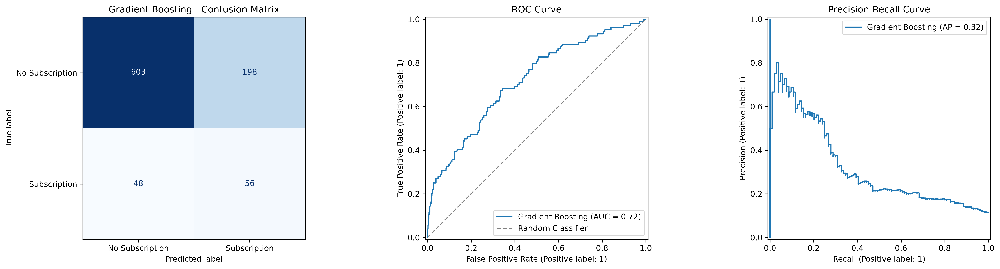
<figcaption>Figure 12.1: Selected Model Evaluation</figcaption>
</figure>

### 12.5 Confusion Matrix Analysis

A confusion matrix compares actual classes with predicted classes.

The confusion matrix at the default threshold of 0.50 is:

| Actual Class | Predicted No | Predicted Yes |
|---|---:|---:|
| Actual No | 603 | 198 |
| Actual Yes | 48 | 56 |

The four outcomes are:

- **True Negative (TN): 603** — Non-subscribers correctly classified as non-subscribers.
- **False Positive (FP): 198** — Non-subscribers incorrectly classified as potential subscribers.
- **False Negative (FN): 48** — Actual subscribers incorrectly classified as non-subscribers.
- **True Positive (TP): 56** — Actual subscribers correctly identified.

The confusion matrix shows that the model identifies more than half of the actual subscribers at the default threshold, but also produces a relatively large number of false positives.

### 12.6 Training and Validation Performance

Training and validation performance were compared to investigate possible overfitting.

| Metric | Training | Validation |
|---|---:|---:|
| Accuracy | 0.7494 | 0.7282 |
| Precision | 0.2548 | 0.2205 |
| Recall | 0.6091 | 0.5385 |
| F1-score | 0.3593 | 0.3128 |
| ROC-AUC | 0.7652 | 0.7171 |
| PR-AUC | 0.3949 | 0.3211 |

The training results are higher than the validation results across the reported metrics.

However, the differences are relatively limited, and the evaluation report does not indicate severe overfitting.

The training-validation comparison provides a useful indication of generalization within the available data split. It does not guarantee equivalent performance on future or independent customer data.

### 12.7 Classification Threshold Optimization

A classification threshold determines how predicted probabilities are converted into final class labels.

The default threshold of 0.50 was compared with the selected threshold of 0.7419.

The selected threshold was identified through the threshold analysis performed during Phase 7.

The reproducible Phase 9 validation results are:

| Metric | Threshold 0.50 | Threshold 0.7419 |
|---|---:|---:|
| Accuracy | 0.7282 | 0.8807 |
| Precision | 0.2205 | 0.4655 |
| Recall | 0.5385 | 0.2596 |
| F1-score | 0.3128 | 0.3333 |
| ROC-AUC | 0.7171 | 0.7171 |
| PR-AUC | 0.3211 | 0.3211 |

The ROC-AUC and PR-AUC remain unchanged because they are calculated using predicted probabilities rather than threshold-based class predictions.

The threshold comparison shows that increasing the threshold improves precision and F1-score, but reduces recall.

<figure class="report-figure">
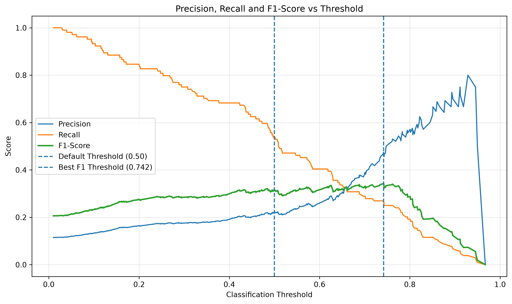
<figcaption>Figure 12.2: Threshold Performance Comparison</figcaption>
</figure>

### 12.8 Business Impact of Threshold Selection

The classification threshold changes the number of customers identified for potential marketing contact.

The comparison of confusion matrix results is:

| Measure | Threshold 0.50 | Threshold 0.7419 |
|---|---:|---:|
| True Positives | 56 | 27 |
| False Positives | 198 | 31 |
| False Negatives | 48 | 77 |
| True Negatives | 603 | 770 |
| Customers Classified as Potential Subscribers | 254 | 58 |
| Actual Subscribers Identified | 56 | 27 |
| Actual Subscribers Missed | 48 | 77 |

At the default threshold of 0.50, the model identifies 254 customers for potential contact, including 56 actual subscribers.

At the selected threshold of 0.7419, the model identifies 58 customers for potential contact, including 27 actual subscribers.

Therefore:

- The default threshold identifies more actual subscribers but produces more false positives.
- The selected threshold reduces the number of potential marketing contacts.
- The selected threshold also misses more actual subscribers.

The choice of threshold should depend on the bank's marketing budget, cost of contacting customers and value of successful subscriptions.

### 12.9 Five-Fold Cross-Validation

Stratified five-fold cross-validation was performed on the training data to examine the consistency of model performance across different data partitions.

The recorded results were:

| Metric | Cross-Validation Mean | Standard Deviation |
|---|---:|---:|
| Accuracy | 0.7411 | 0.0157 |
| Precision | 0.2233 | 0.0085 |
| Recall | 0.5039 | 0.0715 |
| F1-score | 0.3085 | 0.0192 |
| ROC-AUC | 0.7103 | 0.0292 |
| PR-AUC | 0.3202 | 0.0352 |

The cross-validation results indicate reasonably consistent F1-score performance across the five folds.

Recall shows greater variation than accuracy and F1-score, suggesting that the identification of minority-class customers is more sensitive to the particular data partition.

<figure class="report-figure">
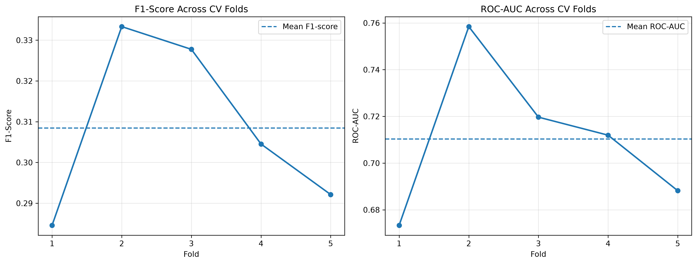
<figcaption>Figure 12.3: Cross-Validation Stability</figcaption>
</figure>

### 12.10 Validation Limitations

The evaluation results must be interpreted in the context of the available data.

The following limitations apply:

1. The validation dataset was used for model comparison and threshold selection.
2. Validation performance is not an independent estimate of real-world performance.
3. No separate labelled test dataset was available for final performance confirmation.
4. The additional `test.csv` file contains no target labels, so accuracy and other supervised evaluation metrics cannot be calculated for it.
5. The business profitability of the model cannot be calculated without information about marketing costs and subscription revenue.

The selected threshold and validation metrics should therefore be treated as experimental results rather than guaranteed future performance.

### 12.11 Final Evaluation Summary

The selected Gradient Boosting model achieved the following results in the reproducible Phase 9 validation workflow:

- Accuracy: 0.7282 at threshold 0.50.
- Precision: 0.2205 at threshold 0.50.
- Recall: 0.5385 at threshold 0.50.
- F1-score: 0.3128 at threshold 0.50.
- F1-score: 0.3333 at threshold 0.7419.
- ROC-AUC: 0.7171.
- PR-AUC: 0.3211.

The selected threshold of 0.7419 improves precision and F1-score while reducing recall.

The original Phase 7 notebook recorded a maximum validation F1-score of 0.3436 at the same threshold. The later Phase 9 workflow produced slightly different validation probabilities and metrics. The Phase 9 results are used as the final reproducible figures in this report.

### 12.12 Conclusion

The evaluation phase examined the selected Gradient Boosting model using multiple classification metrics, confusion matrix analysis, training-validation comparison, threshold optimization and five-fold cross-validation.

The results demonstrate that the model can identify potential subscribers, although its performance involves a trade-off between precision and recall.

The selected threshold reduces the number of customers classified for potential contact, but also increases the number of actual subscribers missed.

The evaluation highlights the importance of selecting classification metrics and thresholds according to the business objective rather than relying only on accuracy.

Further evaluation using an independent labelled dataset would be necessary to establish the model's performance on unseen real-world customers.

## 13. Business Insights and Recommendations

### 13.1 Introduction

The main objective of business analysis is to convert machine learning results into useful information that can support banking and marketing decisions.

In this project, the selected Gradient Boosting model was analyzed using customer segments, feature importance and predicted subscription probabilities.

The findings help identify customer groups with different observed subscription rates and understand which variables contribute to the model's predictions.

These insights can support targeted marketing strategies, better allocation of campaign resources and more informed customer prioritization.

### 13.2 Customer Segment Analysis

Customer segmentation was performed to identify differences in subscription behaviour across demographic and campaign-related categories.

#### 13.2.1 Job-Based Customer Analysis

The subscription rates across job categories are:

| Job Category | Customers | Subscribers | Subscription Rate |
|---|---:|---:|---:|
| Retired | 230 | 54 | 23.48% |
| Student | 84 | 19 | 22.62% |
| Management | 969 | 131 | 13.52% |
| Blue-collar | 946 | 69 | 7.29% |

Retired and student customers show relatively high observed subscription rates.

Management represents the largest customer group among the categories listed, while blue-collar customers show the lowest observed subscription rate.

**Business insight:** Retired and student customer segments may deserve further investigation for targeted marketing campaigns. However, campaign decisions should also consider customer preferences and sample sizes.

#### 13.2.2 Marital Status Analysis

The observed subscription rates by marital status are:

| Marital Status | Customers | Subscribers | Subscription Rate |
|---|---:|---:|---:|
| Divorced | 528 | 77 | 14.58% |
| Single | 1,196 | 167 | 13.96% |
| Married | 2,797 | 277 | 9.90% |

Divorced and single customers show higher observed subscription rates than married customers.

**Business insight:** Marital status may be considered as one of several variables during customer segmentation. It should not be used as the sole basis for marketing decisions.

#### 13.2.3 Education-Based Analysis

The observed subscription rates across education categories are:

| Education | Customers | Subscribers | Subscription Rate |
|---|---:|---:|---:|
| Tertiary | 1,350 | 193 | 14.30% |
| Secondary | 2,306 | 245 | 10.62% |
| Unknown | 187 | 19 | 10.16% |
| Primary | 678 | 64 | 9.44% |

Tertiary-educated customers show the highest observed subscription rate among the education groups.

**Business insight:** Education-related patterns may help describe customer segments, but they should be interpreted alongside other customer characteristics.

#### 13.2.4 Contact Type Analysis

The subscription rates based on contact type are:

| Contact Type | Customers | Subscribers | Subscription Rate |
|---|---:|---:|---:|
| Telephone | 301 | 44 | 14.62% |
| Cellular | 2,896 | 416 | 14.36% |
| Unknown | 1,324 | 61 | 4.61% |

Telephone and cellular contact categories have similar observed subscription rates, whereas the unknown category has a substantially lower rate.

**Business insight:** Recording accurate contact information may help improve customer analysis and campaign planning.

#### 13.2.5 Previous Campaign Outcome Analysis

Previous campaign outcomes show an important difference in observed subscription behaviour.

| Previous Outcome | Customers | Subscribers | Subscription Rate |
|---|---:|---:|---:|
| Success | 129 | 83 | 64.34% |
| Other | 197 | 38 | 19.29% |
| Failure | 490 | 63 | 12.86% |
| Unknown | 3,705 | 337 | 9.10% |

Customers with a previous successful campaign outcome have the highest observed subscription rate.

**Business insight:** Previous campaign outcomes may provide valuable information when prioritizing customers for future marketing interactions.

### 13.3 Feature Importance Analysis

Feature importance was examined to understand which input variables contributed most to the predictions made by the selected Gradient Boosting model.

The leading features were:

| Feature | Importance |
|---|---:|
| Contact: Cellular | 0.29163 |
| Previous contact days (`pdays`) | 0.08893 |
| Account balance (`balance`) | 0.06968 |
| Personal loan: Yes | 0.06427 |
| Last contact day (`day`) | 0.05086 |
| Campaign contacts (`campaign`) | 0.04894 |

The `contact_cellular` feature has the highest importance among the reported features.

Previous contact days, account balance, personal loan status and campaign-related information also contribute to the model's predictions.

<figure class="report-figure">
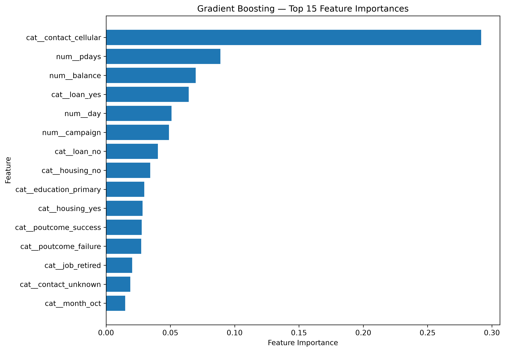
<figcaption>Figure 13.1: Feature Importance of the Selected Gradient Boosting Model</figcaption>
</figure>

**Business insight:** The bank can examine contact history, customer account characteristics and campaign information when designing marketing strategies.

Feature importance represents predictive contribution within the fitted model. It does not establish that changing a feature will cause a change in subscription behaviour.

### 13.4 Predicted Probability Analysis

Predicted probability analysis was performed on the validation dataset containing 905 customers.

The model assigned each customer a probability of subscribing to a term deposit.

For interpretation, customers were divided into five probability groups.

| Probability Group | Customers | Actual Subscribers | Average Predicted Probability | Actual Subscription Rate |
|---|---:|---:|---:|---:|
| 0–20% | 372 | 17 | 10.43% | 4.57% |
| 20–40% | 162 | 16 | 29.25% | 9.88% |
| 40–60% | 210 | 29 | 49.54% | 13.81% |
| 60–80% | 126 | 22 | 67.99% | 17.46% |
| 80–100% | 35 | 20 | 86.17% | 57.14% |

The highest probability group, containing 35 customers, has the highest observed subscription rate at 57.14%.

The lowest probability group contains 372 customers and has an observed subscription rate of 4.57%.

The observed subscription rate generally increases across the probability groups, indicating that the model provides useful ranking information for customer prioritization.

<figure class="report-figure">
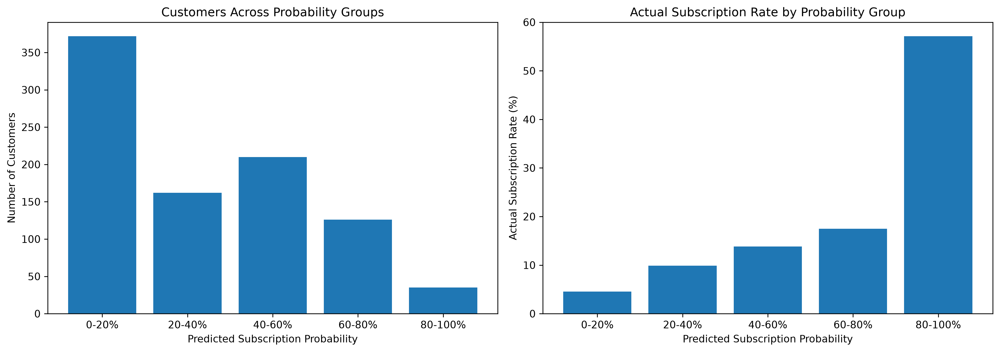
<figcaption>Figure 13.2: Predicted Probability Analysis</figcaption>
</figure>

**Business insight:** Predicted probabilities can help organize customers into different priority groups. However, they are estimates and do not guarantee that an individual customer will subscribe.

### 13.5 Marketing Recommendations

Based on the customer analysis, feature importance and probability analysis, the following recommendations are proposed.

#### 13.5.1 Prioritize High-Probability Customers

Customers with predicted subscription probabilities above 60% may be considered for higher-priority personal calls and follow-ups.

The validation analysis shows higher observed subscription rates in the 60–80% and 80–100% groups.

#### 13.5.2 Develop Strategies for Medium-Probability Customers

Customers with probabilities between 20% and 60% may be considered for targeted communication, suitable product information and follow-up campaigns.

Their response can be monitored to understand whether additional engagement improves campaign outcomes.

#### 13.5.3 Use Cost-Effective Communication for Lower-Probability Customers

Customers with lower predicted probabilities may be considered for less resource-intensive communication methods, subject to their preferences and applicable communication requirements.

This can help avoid allocating the same level of calling resources to every customer.

#### 13.5.4 Consider Previous Campaign Outcomes

Previous campaign success is strongly associated with subscription in the dataset.

Banks may consider previous campaign outcomes when organizing customer follow-ups and identifying potentially interested customers.

#### 13.5.5 Improve Resource Allocation

The predicted probability groups can help marketing teams organize calling priorities and allocate staff according to campaign objectives and available resources.

#### 13.5.6 Monitor Actual Campaign Results

Actual customer responses should be compared with model predictions.

Periodic monitoring can help identify changes in customer behaviour and determine whether the model requires retraining or further evaluation.

### 13.6 Business Value of the Proposed System

The proposed system can support banking marketing operations in several ways:

1. **Customer prioritization:** Helps organize customers according to predicted subscription probability.
2. **Campaign planning:** Provides additional information for designing targeted marketing campaigns.
3. **Resource allocation:** Helps prioritize calling resources and marketing effort.
4. **Customer analysis:** Identifies differences in observed subscription rates across customer segments.
5. **Decision support:** Provides probability estimates that can be considered alongside human judgement.
6. **Performance monitoring:** Supports comparison between predicted outcomes and actual campaign results.

The system is intended to assist marketing decisions rather than replace human decision-making.

### 13.7 Business and Model Limitations

The findings must be interpreted with the following limitations:

- The dataset contains 4,521 labelled customer records.
- The positive class represents only 11.52% of the dataset.
- Observed subscription rates do not establish causal relationships.
- Customer preferences and campaign effectiveness may change over time.
- Predicted probabilities do not guarantee subscription outcomes.
- Validation results are not an independent estimate of future performance.
- Feature importance may vary across models and datasets.
- Actual campaign profitability cannot be calculated without marketing costs and subscription revenue information.

Independent testing on future campaign data is required before production use.

### 13.8 Ethical Considerations

The use of predictive models in banking marketing should consider customer privacy, fairness and responsible decision-making.

The following practices are recommended:

1. Protect customer information and use it only for authorized purposes.
2. Evaluate the model for potentially unfair differences across customer groups.
3. Maintain transparency about how predictions influence marketing prioritization.
4. Avoid excessive or unwanted marketing communication.
5. Retain human oversight in final campaign decisions.
6. Follow applicable data-protection requirements.

The model should be used as a decision-support system rather than an automatic mechanism for making customer decisions.

### 13.9 Conclusion

The business-insights phase translated the machine learning results into practical observations and recommendations for bank marketing campaigns.

Customer segment analysis identified differences in observed subscription rates across job, marital status, education, contact type and previous campaign outcomes.

Feature importance highlighted the contribution of contact type, previous contact history, account balance and other campaign-related variables to model predictions.

Predicted probability analysis demonstrated that customers in higher probability groups generally had higher observed subscription rates in the validation dataset.

Based on these findings, the proposed system can support customer prioritization, targeted marketing and resource allocation.

Overall, the Gradient Boosting model provides a decision-support approach for identifying potential term-deposit subscribers. Its use should remain subject to independent testing, fairness checks, customer privacy protection and continuous performance monitoring.

## 14. Streamlit Application and Deployment

### 14.1 Introduction

The final phase of the project involves integrating the trained machine learning model into an interactive web application.

Streamlit was selected to develop a user-friendly interface through which users can enter customer information, upload customer datasets, generate predictions and explore model performance.

The application uses the saved Gradient Boosting pipeline and its associated metadata to generate subscription predictions.

The primary objective is to make the machine learning system accessible to users without requiring them to execute the training notebooks or write Python code.

### 14.2 Application Architecture

The application follows a modular architecture in which the trained model, configuration files, evaluation results and user interface work together.

The main components are:

1. **Streamlit Interface:** Provides navigation and interactive application pages.
2. **Saved ML Model:** Contains the trained Gradient Boosting pipeline.
3. **Model Metadata:** Stores feature information, preprocessing details, model configuration and decision threshold.
4. **Prediction Functions:** Validate input data and generate subscription probabilities.
5. **Evaluation Results:** Supplies validation metrics and confusion matrix information.
6. **Business Insights:** Displays feature importance and customer probability analysis.

The application loads the saved model using Joblib and reuses the preprocessing transformations included in the pipeline.

This ensures consistency between model training and prediction.

### 14.3 Technology Stack

The application uses the following technologies:

| Technology | Purpose |
|---|---|
| Python | Application development |
| Streamlit | Interactive web interface |
| Pandas | Customer data handling |
| NumPy | Numerical operations |
| Scikit-learn | Machine learning model |
| Imbalanced-learn | SMOTENC pipeline integration |
| Matplotlib | Model performance visualization |
| Joblib | Model loading and serialization |
| JSON | Model metadata and evaluation configuration |

### 14.4 Application Navigation

The application provides five main sections through a sidebar navigation menu.

These sections are:

1. Home
2. Customer Prediction
3. Batch Prediction
4. Model Performance
5. Business Insights

The sidebar also displays the selected model name, number of input features and decision threshold.

The selected model is Gradient Boosting, with 15 input features and a decision threshold of 0.7419.

### 14.5 Home Page

The Home page introduces the Bank Marketing Subscription Prediction system.

It displays:

- Project overview and objectives.
- Number of training records.
- Number of input features.
- Selected machine learning algorithm.
- Main application capabilities.
- Technologies used in the project.

The page provides an overview of individual prediction, batch prediction, model performance and business insights.

<figure class="report-figure">
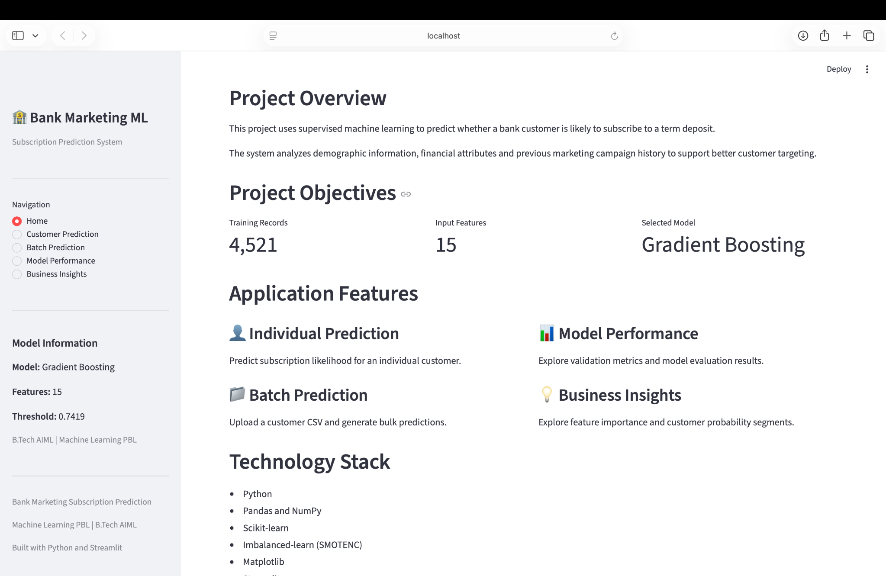
<figcaption>Figure 14.1: Application Home Page</figcaption>
</figure>

### 14.6 Individual Customer Prediction

The Customer Prediction page allows users to enter information about an individual bank customer.

The input form is divided into three groups.

**1. Customer Demographics**

- Age
- Job
- Marital status
- Education
- Account balance
- Credit in default

**2. Loan and Contact Information**

- Housing loan
- Personal loan
- Contact type
- Last contact day
- Last contact month
- Number of contacts during the current campaign

**3. Previous Campaign Information**

- Days since previous contact
- Number of previous contacts
- Previous campaign outcome

The application collects all 15 required model features.

After submitting the form, the application generates a subscription probability using the saved model pipeline.

The predicted class is determined using the selected threshold of 0.7419.

The results include:

- Predicted subscription outcome (Yes or No).
- Subscription probability.
- Decision threshold.
- Marketing priority category.

Marketing priority is assigned using the predicted probability:

| Probability Range | Marketing Priority |
|---|---|
| Below 20% | Very Low |
| 20% to below 40% | Low |
| 40% to below 60% | Medium |
| 60% to below 80% | High |
| 80% to 100% | Very High |

<figure class="report-figure">
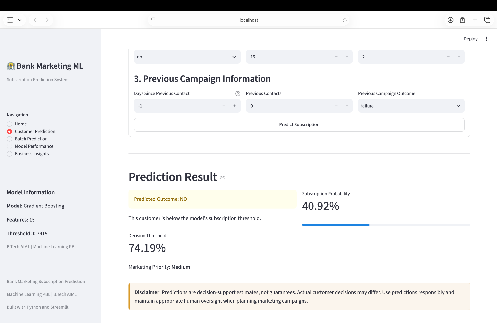
<figcaption>Figure 14.2: Individual Customer Prediction Page</figcaption>
</figure>

### 14.7 Batch Customer Prediction

The Batch Prediction page allows users to upload a CSV file containing multiple customer records.

The application processes the uploaded file and generates predictions for all valid records.

The workflow consists of the following steps:

1. Upload a customer CSV file.
2. Read and preview the uploaded records.
3. Check whether all required model features are available.
4. Remove non-model columns such as `Id`, `duration`, `y` and `subscribed`, when present.
5. Validate numerical inputs.
6. Generate subscription probabilities and predicted classes.
7. Assign marketing priority categories.
8. Display the prediction results.
9. Download the resulting CSV file.

The output contains four additional prediction columns:

- `subscription_probability`
- `predicted_class`
- `predicted_subscription`
- `marketing_priority`

The application also displays the total number of customers and the counts of predicted Yes and No outcomes.

The downloaded file is named `bank_marketing_predictions.csv`.

<figure class="report-figure">
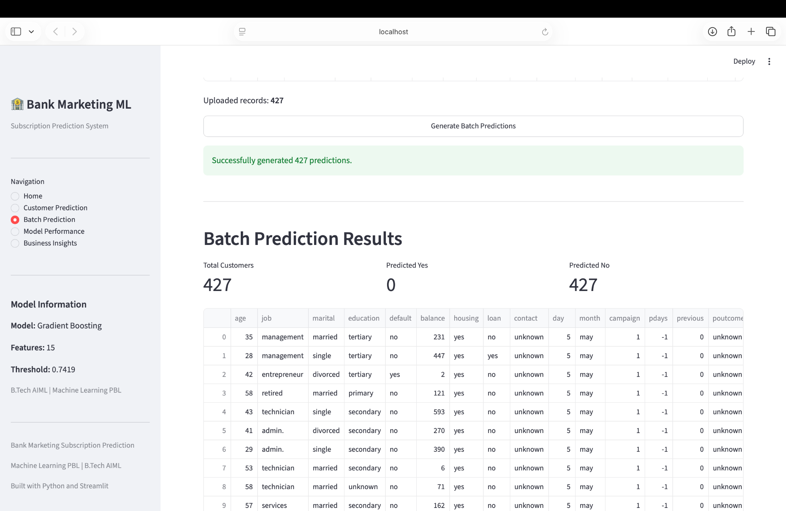
<figcaption>Figure 14.3: Batch Customer Prediction Page</figcaption>
</figure>

### 14.8 Model Performance Page

The Model Performance page presents the validation results of the selected Gradient Boosting classifier.

It displays six evaluation metrics at the selected decision threshold:

1. Accuracy
2. Precision
3. Recall
4. F1-score
5. ROC-AUC
6. PR-AUC

The page also compares the default threshold of 0.50 with the selected threshold of 0.7419.

A bar chart is used to visualize the differences in accuracy, precision, recall and F1-score.

The confusion matrix is displayed to show the number of:

- True Negatives
- False Positives
- False Negatives
- True Positives

Additional model information includes the algorithm, preprocessing methods, training dataset size, number of features and excluded `duration` feature.

The page clearly indicates that the displayed performance metrics come from the validation split and that the saved model pipeline was subsequently retrained using the complete labelled dataset.

<figure class="report-figure">
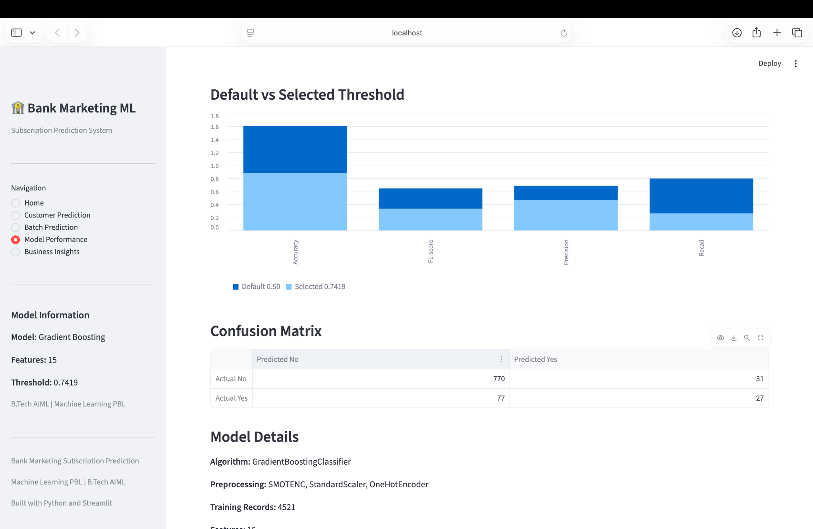
<figcaption>Figure 14.4: Model Performance Page</figcaption>
</figure>

### 14.9 Business Insights Page

The Business Insights page presents information that can help users understand the selected model and customer subscription patterns.

It contains three main sections.

**1. Feature Importance**

The application displays the ten most important features from the saved feature-importance results using a horizontal bar chart.

This helps users understand which variables contribute to the model's predictions.

**2. Customer Probability Analysis**

The page displays customer probability groups and their corresponding actual subscription rates from the validation dataset.

A bar chart provides a visual comparison of subscription rates across probability groups.

**3. Marketing Recommendations**

The application provides recommendations related to:

- Prioritizing promising customers.
- Allocating marketing resources.
- Reviewing customer segments.
- Maintaining human oversight.
- Monitoring model performance.

The page also explains that predictive relationships do not establish causation.

<figure class="report-figure">
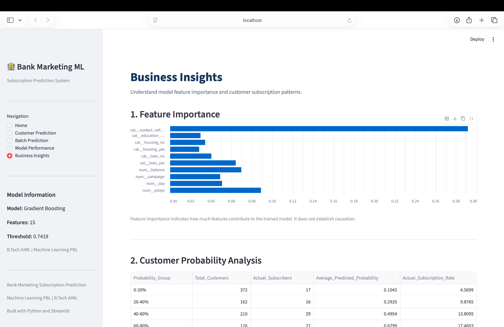
<figcaption>Figure 14.5: Business Insights Page</figcaption>
</figure>

### 14.10 Model Integration and Prediction Workflow

The application loads the saved model using the Joblib library.

The model-loading function uses Streamlit's `st.cache_resource` decorator to avoid repeatedly loading the model during application interactions.

Model metadata and evaluation results are loaded separately using cached data-loading functions.

The prediction workflow is:

1. Receive customer information through the individual form or uploaded CSV.
2. Verify that all required model features are available.
3. Convert numerical columns into appropriate numeric values.
4. Check for missing or invalid input values.
5. Select the 15 features required by the saved model.
6. Pass the validated data to the saved machine learning pipeline.
7. Generate subscription probabilities using `predict_proba()`.
8. Apply the stored decision threshold of 0.7419.
9. Generate the predicted subscription class.
10. Assign the corresponding marketing priority.

The preprocessing transformations are already included in the saved pipeline. Therefore, the application does not independently repeat scaling, encoding or SMOTENC operations.

This approach maintains consistency between training and inference.

### 14.11 Input Validation and Error Handling

Input validation is important to ensure that the application can handle incorrect or incomplete customer information.

The application includes the following checks:

- Model-file availability before loading.
- Availability of the required model features.
- Conversion of numerical inputs into numeric values.
- Detection of missing or invalid numerical values.
- Detection of missing CSV columns.
- Detection of empty uploaded datasets.
- Handling of CSV-reading errors.
- Handling of prediction errors.

For batch prediction, non-model columns such as `Id`, `duration`, `y` and `subscribed` are removed before prediction when present.

The application also handles model-loading failures by displaying an error message and stopping execution when the required model or configuration cannot be loaded.

### 14.12 Application Testing

The application was tested using different scenarios to verify its functionality.

The testing included:

1. Opening the Home page and checking the project information.
2. Entering customer details and generating an individual prediction.
3. Uploading a CSV file and generating batch predictions.
4. Downloading the prediction results.
5. Viewing model evaluation metrics and the confusion matrix.
6. Viewing feature importance and probability analysis.
7. Testing CSV files with missing required columns.
8. Testing missing and invalid numerical values.
9. Testing previously unseen categorical values.
10. Testing malformed CSV input.

These tests helped verify the main application workflow and its handling of common input errors.

### 14.13 Application Execution

The application can be executed locally from the project root directory.

First, activate the Python virtual environment:

```bash
source .venv/bin/activate
```

Install the project dependencies:

```bash
pip install -r requirements.txt
```

Start the Streamlit application:

```bash
streamlit run app.py
```

Streamlit starts a local web server and provides a browser address through which the application can be accessed.

The application requires the saved model artifact, metadata, evaluation results and associated report files to be available at their expected project paths.

### 14.14 Responsible Use and Disclaimer

The application is intended to support marketing analysis and customer prioritization.

Predicted subscription probabilities are estimates generated by a machine learning model. They do not guarantee actual customer decisions.

The application communicates this limitation through a disclaimer.

Human oversight should be maintained when using predictions to plan marketing campaigns. Customer privacy, fairness and applicable data-protection requirements should also be considered.

### 14.15 Conclusion

The Streamlit application provides an interactive interface for using the trained Gradient Boosting model.

It integrates individual customer prediction, batch prediction, model performance evaluation and business insights into a single application.

The use of a saved preprocessing and classification pipeline ensures consistency between model development and prediction.

Input validation, error handling and downloadable batch results make the application more practical for demonstration and decision-support purposes.

Overall, the application completes the implementation and local deployment component of the Bank Marketing Subscription Prediction project.

## 15. Results and Discussion

### 15.1 Introduction

This chapter presents the results obtained during the development and evaluation of the Bank Marketing Subscription Prediction system.

The results cover comparative model evaluation, the performance of the selected Gradient Boosting classifier, classification threshold analysis, cross-validation and prediction generation on the separate unlabeled dataset.

The primary evaluation is based on the stratified validation dataset containing 905 customer records.

### 15.2 Dataset Summary

The project used the Bank Marketing dataset containing 4,521 labelled customer records.

The target variable represents whether a customer subscribed to a term deposit.

| Class | Number of Customers | Percentage |
|---|---:|---:|
| No | 4,000 | 88.48% |
| Yes | 521 | 11.52% |
| Total | 4,521 | 100% |

The dataset contains an imbalanced target distribution, with non-subscribers representing the majority class.

After excluding the `duration` feature because of potential leakage in pre-call prediction, the final model uses 15 input features.

### 15.3 Comparative Model Evaluation

Five machine learning algorithms were evaluated using a consistent validation framework.

The algorithms were:

1. Logistic Regression
2. Decision Tree
3. Random Forest
4. Support Vector Machine (SVM)
5. Gradient Boosting

The comparative results are:

| Model | Accuracy | Precision | Recall | F1-score | ROC-AUC | PR-AUC |
|---|---:|---:|---:|---:|---:|---:|
| Logistic Regression | 0.6707 | 0.1891 | 0.5673 | 0.2837 | 0.6882 | 0.2901 |
| Decision Tree | 0.6519 | 0.1754 | 0.5481 | 0.2657 | 0.6673 | 0.2380 |
| Random Forest | 0.6961 | 0.2082 | 0.5865 | 0.3073 | 0.7022 | 0.2997 |
| SVM | 0.5890 | 0.1763 | 0.7019 | 0.2819 | 0.6905 | 0.2492 |
| Gradient Boosting | 0.7282 | 0.2205 | 0.5385 | 0.3128 | 0.7171 | 0.3211 |

Based on the recorded comparative validation results, Gradient Boosting achieved the highest F1-score, ROC-AUC and PR-AUC among the five evaluated algorithms.

Random Forest achieved a slightly higher recall than Gradient Boosting, while SVM achieved the highest recall in this comparison.

However, Gradient Boosting provided the strongest overall balance according to the selected F1-score and ranking metrics.

Therefore, Gradient Boosting was selected for the final model pipeline.

### 15.4 Final Gradient Boosting Model Performance

The selected Gradient Boosting model was evaluated on a validation dataset containing 905 records.

The validation dataset consisted of:

- 801 non-subscribers.
- 104 subscribers.

At the default classification threshold of 0.50, the model achieved the following results:

| Evaluation Metric | Result |
|---|---:|
| Accuracy | 0.7282 |
| Precision | 0.2205 |
| Recall | 0.5385 |
| F1-score | 0.3128 |
| ROC-AUC | 0.7171 |
| PR-AUC | 0.3211 |

These results demonstrate that the model can identify potential subscribers, although precision and recall involve a trade-off.

The PR-AUC metric is particularly relevant because the dataset contains a relatively small proportion of positive subscription cases.

### 15.5 Confusion Matrix Analysis

At the default threshold of 0.50, the confusion matrix was:

| | Predicted No | Predicted Yes |
|---|---:|---:|
| Actual No | 603 | 198 |
| Actual Yes | 48 | 56 |

The results can be interpreted as follows:

- **True Negatives (603):** Non-subscribers correctly classified as No.
- **False Positives (198):** Non-subscribers incorrectly classified as Yes.
- **False Negatives (48):** Actual subscribers incorrectly classified as No.
- **True Positives (56):** Actual subscribers correctly classified as Yes.

The model identified 56 of the 104 actual subscribers at the default threshold.

The relatively high number of false positives indicates that the model also classifies several non-subscribers as potential subscribers.

### 15.6 Classification Threshold Comparison

The default classification threshold of 0.50 was compared with the selected threshold of 0.7419.

The selected threshold was obtained through validation-based threshold analysis.

The comparison is shown below:

| Metric | Threshold 0.50 | Threshold 0.7419 |
|---|---:|---:|
| Accuracy | 0.7282 | 0.8807 |
| Precision | 0.2205 | 0.4655 |
| Recall | 0.5385 | 0.2596 |
| F1-score | 0.3128 | 0.3333 |
| ROC-AUC | 0.7171 | 0.7171 |
| PR-AUC | 0.3211 | 0.3211 |

The confusion matrix at the selected threshold of 0.7419 is:

| | Predicted No | Predicted Yes |
|---|---:|---:|
| Actual No | 770 | 31 |
| Actual Yes | 77 | 27 |

At this threshold:

- 58 customers are classified as potential subscribers.
- 27 actual subscribers are correctly identified.
- 31 non-subscribers are incorrectly classified as potential subscribers.
- 77 actual subscribers are missed.

The higher threshold improves precision and reduces the number of customers classified for potential contact.

However, it also reduces recall because more actual subscribers are classified as No.

The selected threshold therefore represents a trade-off between marketing contact volume and the identification of potential subscribers.

### 15.7 Cross-Validation Results

Five-fold stratified cross-validation was performed on the training portion of the dataset to examine the consistency of model performance.

The recorded results were:

| Metric | Cross-Validation Mean | Standard Deviation |
|---|---:|---:|
| Accuracy | 0.7411 | 0.0157 |
| Precision | 0.2233 | 0.0085 |
| Recall | 0.5039 | 0.0715 |
| F1-score | 0.3085 | 0.0192 |
| ROC-AUC | 0.7103 | 0.0292 |
| PR-AUC | 0.3202 | 0.0352 |

The relatively small standard deviation in F1-score and ROC-AUC indicates reasonably consistent performance across the five folds.

Recall shows greater variation than some of the other metrics.

Overall, cross-validation provides additional evidence about model stability within the available training data.

### 15.8 Predictions on the Separate Test Dataset

A separate dataset named `test.csv` was provided for generating additional customer predictions.

Its characteristics are:

| Property | Result |
|---|---:|
| Records | 427 |
| Columns | 17 |
| Predictor features shared with training data | 16 |
| Target labels available | No |
| Missing values | 0 |
| Duplicate records | 0 |
| Duplicate IDs | 0 |

The dataset contains an `Id` column for record identification and does not contain the actual target variable `y`.

The saved Gradient Boosting pipeline was used to generate predictions for these records.

At the selected decision threshold of 0.7419:

- Total records processed: 427.
- Predicted subscribers (Yes): 0.
- Predicted non-subscribers (No): 427.
- Predicted subscription probabilities ranged approximately from 0.0126 to 0.3608.

The absence of predicted Yes outcomes indicates that none of the 427 records reached the selected classification threshold.

However, this does not establish that all 427 customers are actual non-subscribers.

Since the true target labels are unavailable, accuracy, precision, recall and F1-score cannot be calculated for this dataset.

The predictions should therefore be interpreted as model-generated estimates rather than verified outcomes.

### 15.9 Reproducibility and Additional Evaluation Considerations

The final training workflow records the selected model configuration, preprocessing transformations, decision threshold and model metadata.

The selected Gradient Boosting pipeline was subsequently retrained using all 4,521 labelled records and saved as a Joblib artifact.

The model artifact is stored at:

`models/best_model.joblib`

The associated configuration is stored at:

`models/model_metadata.json`

Validation metrics are stored at:

`reports/evaluation_results.json`

An additional evaluation file, `reports/external_evaluation.json`, records metrics obtained by running the saved model on `bank.csv`.

However, `bank.csv` is the same labelled dataset used to train the final saved model. Consequently, those results are not an independent test of generalization and are not used as the primary performance results in this chapter.

Independent evaluation using a separate labelled dataset or future campaign records would be necessary to assess performance on genuinely unseen customers.

### 15.10 Overall Project Outcomes

The project achieved the following outcomes:

1. Developed an end-to-end machine learning workflow for bank marketing subscription prediction.
2. Analyzed 4,521 labelled customer records.
3. Investigated five classification algorithms.
4. Applied SMOTENC within the preprocessing and model-training pipeline.
5. Excluded the `duration` feature to avoid potential leakage in pre-call prediction.
6. Selected Gradient Boosting through comparative validation.
7. Evaluated the model using multiple classification and ranking metrics.
8. Investigated the effect of changing the classification threshold.
9. Packaged the trained model and its metadata.
10. Developed a Streamlit application supporting individual and batch predictions.
11. Generated predictions for an additional 427-record dataset without target labels.
12. Developed business insights to support customer prioritization and marketing analysis.

### 15.11 Discussion

The experimental results demonstrate that machine learning can provide useful information for prioritizing potential term-deposit subscribers.

The comparative evaluation identified Gradient Boosting as the strongest overall model according to the recorded F1-score, ROC-AUC and PR-AUC results.

Threshold analysis showed that increasing the classification threshold can reduce the number of customers classified for potential contact while increasing precision.

However, this improvement comes at the cost of lower recall and a larger number of missed subscribers.

The five-fold cross-validation results provide additional information about the consistency of model performance.

The separate unlabeled dataset also demonstrated that the packaged model can process new customer records and generate predictions through the established pipeline.

Nevertheless, the available validation results do not establish real-world campaign effectiveness. Further evaluation on independent labelled customer data is required before operational use.

### 15.12 Conclusion

The results demonstrate the successful implementation of a complete bank marketing subscription prediction workflow.

Gradient Boosting was selected after evaluating five machine learning algorithms and achieved a validation F1-score of 0.3128 at the default threshold and 0.3333 at the selected threshold of 0.7419.

The model also achieved a validation ROC-AUC of 0.7171 and PR-AUC of 0.3211.

Cross-validation provided additional evidence of reasonably consistent performance across training folds.

The project successfully integrated the selected model into a Streamlit application and generated predictions for a separate dataset containing 427 unlabeled customer records.

Overall, the system provides a machine learning-based decision-support approach for customer prioritization. Its future use requires independent testing, responsible implementation and continuous performance monitoring.

## 16. Limitations

### 16.1 Introduction

Although the Bank Marketing Subscription Prediction project successfully implements an end-to-end machine learning workflow, certain limitations must be considered when interpreting its results and planning future use.

These limitations relate to dataset size, class imbalance, model evaluation, prediction reliability, feature availability and real-world deployment.

Understanding these limitations is important to ensure that the system is used responsibly and that its results are not interpreted beyond the available evidence.

### 16.2 Dataset Size and Representativeness

The project uses 4,521 labelled customer records from the Bank Marketing dataset.

Although the dataset provides useful information for developing and evaluating classification models, its size is relatively limited for representing the complete population of bank customers.

Customer behaviour, financial characteristics and marketing responses may differ across banks, geographical regions and time periods.

Therefore, the patterns identified in this dataset may not represent every banking environment.

### 16.3 Class Imbalance

The target variable contains:

- 4,000 non-subscribers (88.48%).
- 521 subscribers (11.52%).

This imbalance makes it difficult for a classification model to identify the minority subscriber class accurately.

Although SMOTENC was applied within the model-training pipeline, the final validation results still demonstrate a trade-off between precision and recall.

The model therefore requires further improvement before being considered for operational marketing decisions.

### 16.4 Model Performance Limitations

The selected Gradient Boosting model achieved:

- F1-score of 0.3128 at threshold 0.50.
- F1-score of 0.3333 at threshold 0.7419.
- ROC-AUC of 0.7171.
- PR-AUC of 0.3211.

These results indicate that the model provides useful predictive information, but its ability to identify subscribers remains limited.

At the selected threshold of 0.7419, the model identifies 27 actual subscribers out of 104 validation subscribers and misses 77.

This demonstrates that the model should not be treated as a completely reliable mechanism for identifying all potential subscribers.

### 16.5 Validation and Independent Testing Limitations

The model was evaluated using a stratified training-validation split.

The validation dataset was also used during model comparison and threshold selection. Therefore, its performance is not a completely independent estimate of generalization.

Five-fold cross-validation was performed on the training portion to examine performance consistency.

However, the project does not include a separate labelled dataset reserved exclusively for final independent testing.

The additional `test.csv` dataset contains 427 records but does not provide actual target labels.

Consequently, its predictions cannot be used to calculate accuracy, precision, recall or F1-score.

Independent evaluation on future labelled campaign records is necessary before the model is used operationally.

### 16.6 Classification Threshold Limitations

The selected classification threshold of 0.7419 was determined using validation-based threshold analysis.

Although this threshold improves precision and F1-score compared with the default threshold of 0.50, it also reduces recall.

The selected threshold identifies fewer potential subscribers and misses more actual subscribers.

The best operating threshold may vary depending on marketing costs, campaign objectives and the value of successful subscriptions.

Therefore, the threshold should be reviewed using business requirements and independent validation data.

### 16.7 Feature Availability and Data Leakage

The `duration` feature was excluded from the final predictive model because it represents the length of the last contact and is known only after the call ends.

This decision supports the project's objective of predicting subscription likelihood before contacting a customer.

However, the dataset contains other campaign-related variables whose availability may depend on the exact point at which a prediction is generated.

For real-world implementation, the bank must ensure that every input feature is available at the intended prediction time.

Using information that becomes available only after a marketing interaction could introduce information leakage.

### 16.8 Prediction Reliability and Probability Interpretation

The application generates subscription probabilities using the saved Gradient Boosting pipeline.

These probabilities are model estimates and do not guarantee actual customer decisions.

The predicted probability groups show differences in observed subscription rates within the validation dataset.

However, these results do not independently establish that the probabilities are perfectly calibrated for future customers.

Additional calibration analysis and evaluation on new labelled data would be useful to assess probability reliability.

### 16.9 Business and Economic Limitations

The project provides customer prioritization and marketing recommendations based on predictive analysis.

However, the available dataset does not provide complete information about:

- Cost per marketing call.
- Total campaign expenditure.
- Revenue generated by successful subscriptions.
- Customer lifetime value.
- Profitability of different marketing strategies.

Therefore, the project cannot establish the actual financial return or profitability of using the prediction system.

A future implementation should integrate campaign cost and revenue information to support cost-sensitive marketing decisions.

### 16.10 Ethical and Privacy Considerations

The model uses customer demographic, financial and campaign-related information.

The use of such information requires appropriate privacy protection and responsible data handling.

The system must also be reviewed for potentially unfair differences in predictions across customer groups.

Predictions should not automatically determine customer eligibility or access to banking products.

Human oversight, transparency, authorized data usage and compliance with applicable data-protection requirements remain important.

### 16.11 Deployment Limitations

The project includes a functional Streamlit application that supports individual and batch predictions.

However, the application was developed and tested as a local demonstration system.

A complete production deployment would require additional engineering, including:

- Secure hosting and access control.
- Authentication and authorization.
- Secure storage of customer information.
- Monitoring of application availability and performance.
- Logging and audit mechanisms.
- Model version management.
- Automated model retraining and validation.
- Integration with authorized banking systems.

These capabilities are outside the current project's implemented scope.

### 16.12 Conclusion

The project successfully demonstrates the development, evaluation, packaging and application integration of a machine learning-based bank marketing prediction system.

Nevertheless, limitations related to dataset size, class imbalance, validation methodology, threshold selection, feature availability and real-world deployment must be considered.

The absence of a separate labelled test dataset also limits the ability to establish independent generalization performance.

These limitations provide important directions for future improvement.

The system should therefore be treated as a decision-support prototype rather than a fully validated production banking solution.

## 17. Conclusion and Future Scope

### 17.1 Overall Project Conclusion

The Bank Marketing Subscription Prediction project focused on developing an end-to-end machine learning system to estimate whether a bank customer is likely to subscribe to a term deposit.

The project followed a complete machine learning workflow, beginning with business problem understanding and dataset analysis, followed by preprocessing, exploratory data analysis, feature engineering, model development, evaluation, business insights and application development.

The UCI Bank Marketing dataset containing 4,521 labelled customer records was used for model development.

Five classification algorithms were investigated: Logistic Regression, Decision Tree, Random Forest, Support Vector Machine and Gradient Boosting.

After comparative evaluation, Gradient Boosting was selected as the final model based on its recorded validation performance.

### 17.2 Summary of Achievements

The major achievements of this project are:

1. **Business Understanding:** Defined the bank marketing subscription prediction problem as a binary classification task.
2. **Dataset Analysis:** Examined customer demographics, financial information and marketing campaign history.
3. **Data Preprocessing:** Prepared numerical and categorical features for machine learning.
4. **Class Imbalance Handling:** Integrated SMOTENC into the model-training pipeline.
5. **Feature Engineering:** Investigated additional features and multiple feature-selection techniques.
6. **Model Development:** Implemented and compared five classification algorithms.
7. **Model Evaluation:** Used accuracy, precision, recall, F1-score, ROC-AUC and PR-AUC to evaluate model performance.
8. **Threshold Optimization:** Investigated the trade-off between precision and recall using different classification thresholds.
9. **Business Insights:** Analyzed customer segments, feature importance and predicted subscription probabilities.
10. **Model Packaging:** Saved the selected preprocessing and classification pipeline using Joblib.
11. **Application Development:** Built a Streamlit application supporting individual and batch predictions.
12. **Documentation:** Prepared project reports, evaluation results, application screenshots and reproducibility instructions.

### 17.3 Final Model Results

Gradient Boosting was selected as the final classification algorithm.

The model achieved the following validation results:

| Metric | Threshold 0.50 | Threshold 0.7419 |
|---|---:|---:|
| Accuracy | 0.7282 | 0.8807 |
| Precision | 0.2205 | 0.4655 |
| Recall | 0.5385 | 0.2596 |
| F1-score | 0.3128 | 0.3333 |
| ROC-AUC | 0.7171 | 0.7171 |
| PR-AUC | 0.3211 | 0.3211 |

The selected threshold of 0.7419 provides higher precision and F1-score than the default threshold in the reproducible validation results.

However, this improvement comes with reduced recall.

The results demonstrate the importance of selecting evaluation metrics and classification thresholds according to the intended business objective.

### 17.4 Practical Application and Project Outcome

The trained model was integrated into an interactive Streamlit application.

The application provides five major sections:

- Home
- Customer Prediction
- Batch Prediction
- Model Performance
- Business Insights

Users can enter individual customer information or upload a CSV file containing multiple customer records.

The application generates subscription probabilities, predicted outcomes and marketing priority categories.

It also provides access to model evaluation results and business-oriented visualizations.

The separate unlabeled dataset containing 427 records was successfully processed through the prediction workflow.

Overall, the project demonstrates how machine learning techniques can be integrated into an interactive decision-support application for banking marketing analysis.

### 17.5 Future Scope

Although the current system demonstrates a complete machine learning implementation, several improvements can be explored in future development.

#### 17.5.1 Use of Larger and More Diverse Datasets

Future work can include larger datasets containing customer records from different banks, geographical regions and campaign periods.

A more diverse dataset may help improve the representativeness of the model.

#### 17.5.2 Independent Model Testing

The model can be evaluated using a separate labelled dataset that has not been used during training, model selection or threshold optimization.

This would provide a stronger estimate of generalization performance.

#### 17.5.3 Advanced Machine Learning Algorithms

Additional algorithms can be investigated, including:

- XGBoost
- LightGBM
- CatBoost
- Advanced ensemble methods
- Neural network-based classification models

Their performance can be compared using a consistent validation methodology.

#### 17.5.4 Improved Class Imbalance Handling

Further experiments can investigate alternative approaches to class imbalance, including:

- Class-weighted learning.
- Random oversampling.
- Alternative SMOTE-based techniques.
- Cost-sensitive classification.
- Ensemble methods designed for imbalanced datasets.

The objective would be to improve minority-class identification while controlling false positives.

#### 17.5.5 Probability Calibration

Future work can investigate probability calibration techniques to assess whether predicted subscription probabilities accurately reflect observed subscription frequencies.

This would make probability-based customer prioritization more informative.

#### 17.5.6 Cost-Sensitive Marketing Optimization

Future versions can incorporate campaign expenditure, calling costs, subscription revenue and customer lifetime value.

This would allow the bank to evaluate marketing decisions based on expected financial benefit rather than predictive metrics alone.

#### 17.5.7 Explainable Artificial Intelligence

Explainability methods such as SHAP can be integrated to provide more detailed explanations of individual predictions and overall model behaviour.

This may improve transparency and support responsible decision-making.

#### 17.5.8 Model Monitoring and Retraining

A future production system could monitor prediction quality and changes in customer behaviour over time.

New labelled campaign data could be used for periodic model evaluation and retraining.

#### 17.5.9 Secure Cloud Deployment

The Streamlit application could be deployed using a secure cloud platform with authentication, access control, monitoring and reliable model storage.

Integration with authorized banking systems could also be explored after appropriate security and compliance reviews.

#### 17.5.10 Responsible and Fair Marketing

Future development should include systematic fairness evaluation across customer groups, stronger privacy controls and transparent decision-support practices.

The system should continue to support human decision-making rather than automatically determine customer treatment.

### 17.6 Final Conclusion

The Bank Marketing Subscription Prediction project successfully demonstrates the implementation of a complete machine learning lifecycle for a real-world-style banking classification problem.

The project combines data analysis, preprocessing, feature engineering, model comparison, evaluation, business insights, model packaging and interactive application development.

Gradient Boosting was selected as the final model, and its saved pipeline was integrated into a Streamlit application for individual and batch customer predictions.

The project also highlights important machine learning considerations, including class imbalance, potential data leakage, threshold selection, evaluation limitations and responsible use of predictive models.

Although further independent testing and improvement are required before production deployment, the completed system provides a practical foundation for machine learning-based customer prioritization in bank marketing campaigns.

Overall, this project demonstrates the application of machine learning concepts to a banking business problem and provides a foundation for future development of more accurate, explainable and responsible predictive systems.

## 18. References

The following sources were consulted during the development, implementation and documentation of the Bank Marketing Subscription Prediction project.

### 18.1 Dataset References

[1] S. Moro, P. Rita, and P. Cortez, "Bank Marketing," UCI Machine Learning Repository, 2014. DOI: https://doi.org/10.24432/C5K306.

[2] S. Moro, P. Cortez, and P. Rita, "A Data-Driven Approach to Predict the Success of Bank Telemarketing," *Decision Support Systems*, vol. 62, pp. 22–31, 2014. DOI: https://doi.org/10.1016/j.dss.2014.03.001.

### 18.2 Research Papers

[3] "Predicting Customer Subscription in Bank Telemarketing Campaigns Using Ensemble Learning Models," *Machine Learning with Applications*, vol. 19, article 100618, 2025. DOI: https://doi.org/10.1016/j.mlwa.2025.100618.

[4] "A Data-Driven Approach for Predicting Term Deposit Subscriptions While Handling Missing and Extremely Imbalanced Bank Telemarketing Data," *2025 20th International Joint Symposium on Artificial Intelligence and Natural Language Processing (iSAI-NLP)*, 2025. DOI: https://doi.org/10.1109/iSAI-NLP66160.2025.11320777.

### 18.3 Machine Learning and Data Processing Documentation

[5] Scikit-learn Developers, "Scikit-learn: Machine Learning in Python." Available: https://scikit-learn.org/stable/.

[6] Imbalanced-learn Developers, "SMOTENC — Synthetic Minority Over-sampling Technique for Nominal and Continuous Features." Available: https://imbalanced-learn.org/stable/references/generated/imblearn.over_sampling.SMOTENC.html.

[7] Pandas Development Team, "Pandas Documentation." Available: https://pandas.pydata.org/docs/.

[8] NumPy Developers, "NumPy Documentation." Available: https://numpy.org/doc/.

### 18.4 Application Development and Model Packaging Documentation

[9] Streamlit, "Streamlit Documentation." Available: https://docs.streamlit.io/.

[10] Joblib Developers, "Joblib Documentation." Available: https://joblib.readthedocs.io/en/stable/.

[11] Python Software Foundation, "Python 3 Documentation." Available: https://docs.python.org/3/.

### 18.5 Project Resources

[12] Bank Marketing Subscription Prediction, Project Source Code and Implementation. GitHub Repository: https://github.com/ajeetsherkar/Bank-Marketing-ML-PBL.

[13] Bank Marketing Subscription Prediction, Project Notebooks, Evaluation Reports, Model Artifacts and Streamlit Application, developed as part of the B.Tech Artificial Intelligence and Machine Learning Project-Based Learning (PBL).

### 18.6 Reference Note

The UCI Bank Marketing dataset and the research publications provided the foundation for understanding the problem and selecting relevant machine learning approaches.

Official documentation for Scikit-learn, Imbalanced-learn, Pandas, NumPy, Streamlit, Joblib and Python was consulted during implementation.

The project-specific notebooks, source code, model evaluation results and reports document the actual experiments and implementation performed in this project.